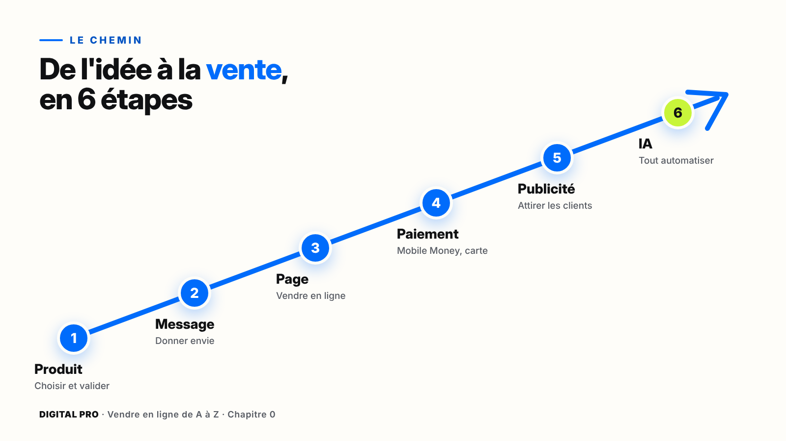
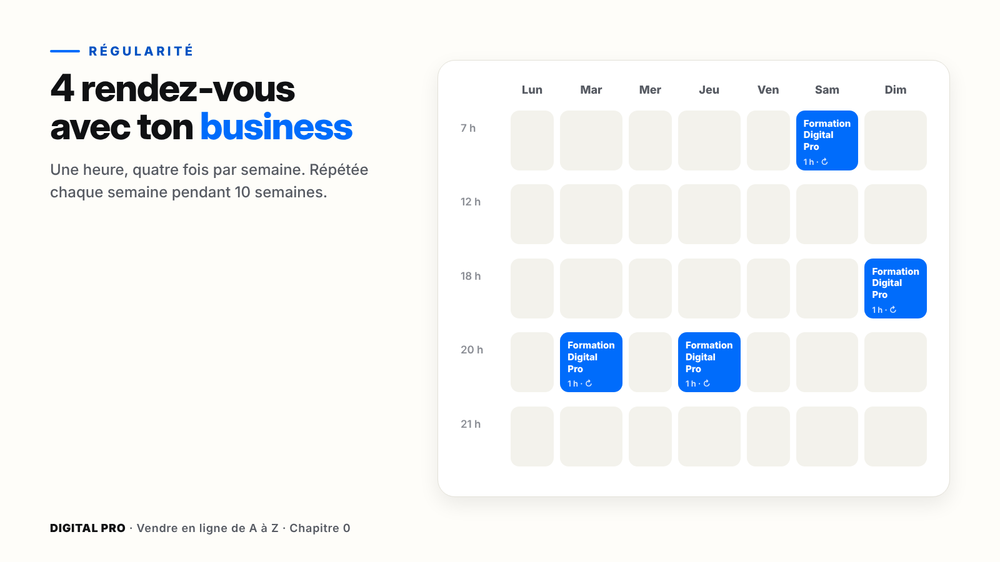
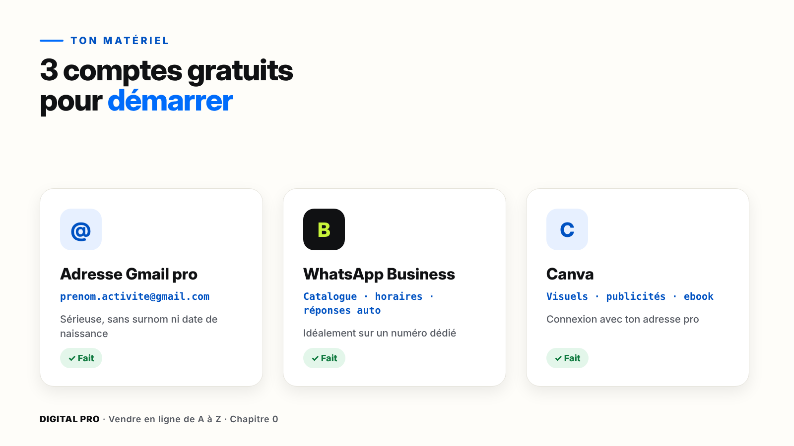

# Chapitre 0 — Bienvenue : prépare ton espace de travail

`[PHOTO]` **Ouverture, pleine page** : une jeune entrepreneuse africaine, assise à une table près d'une fenêtre, en lumière naturelle. Elle sourit en regardant son téléphone. À côté d'elle : un carnet ouvert et une tasse. Ambiance calme et confiante, sans luxe ostentatoire.

> **La promesse de ce chapitre** : en une heure, ton espace de travail est prêt. Ton dossier est créé, ton temps est bloqué, tes comptes sont ouverts. Tu ne fais pas que lire : tu commences.

---

## Ce que tu vas faire dans ce chapitre

- ☐ Comprendre le chemin complet, de l'idée à la vente
- ☐ Créer ton dossier de projet « MON BUSINESS »
- ☐ Régler ta façon de suivre la formation
- ☐ Bloquer 4 rendez-vous par semaine avec ton business
- ☐ Écrire ton objectif à 14 jours
- ☐ Créer tes 3 comptes de départ : Gmail pro, WhatsApp Business, Canva

**Ce qu'il te faut** : ton téléphone, une connexion internet, et la fiche « Mon projet » (dans les ressources du module 0).

---

## 0.1 — Ce que tu vas construire

Imagine. Tu te réveilles, et sur ton téléphone, un message t'attend : « Nouvelle vente ». Quelqu'un a acheté ton produit pendant la nuit.

Ce n'est pas de la magie. Ce n'est pas de la chance. C'est un **système**. Et ce système, tu vas le construire toi-même, marche après marche.

### Le chemin en 6 étapes

| Étape | Ce que tu fais | Où dans la formation |
| --- | --- | --- |
| **1. Produit** | Tu choisis ce que tu vends, et tu vérifies que les gens le veulent. | Modules 2 et 3 |
| **2. Message** | Tu écris le texte et tu crées les visuels qui donnent envie d'acheter. | Module 4 |
| **3. Page** | Tu mets en ligne ta page de vente ou ta boutique. | Module 5 |
| **4. Paiement** | Tu reçois l'argent : Mobile Money, carte ou paiement à la livraison. | Module 6 |
| **5. Publicité** | Tu attires des clients avec Facebook, Instagram, TikTok, Google, LinkedIn. | Modules 7 à 11 |
| **6. IA** | Tu automatises : réponses aux clients, relances, livraisons, suivi. | Module 13 + bonus IA |

### Deux chemins possibles

Tu peux vendre un **produit digital** (une formation, un ebook, un coaching, des modèles) ou un **produit physique** (vêtements, cosmétiques, accessoires…). Les deux marchent. Tu choisiras ton parcours au module 1, et tu le construiras au module 3.

`[PHOTO]` Deux photos côte à côte. **À gauche** : les mains d'une personne qui tient un téléphone affichant une page de formation en ligne. **À droite** : des mains qui emballent un produit cosmétique dans un joli carton, avec une étiquette.

### Pas à pas : crée ton dossier « MON BUSINESS »

C'est là que tu rangeras tout ce que tu construis : idées, photos, textes, fiches.

**Marche 1 — Ouvre Google Drive.**
Cherche l'icône triangle jaune, vert et bleu sur ton téléphone, et appuie dessus.
*Ce que tu dois voir* : l'écran « Accueil » ou « Mon Drive ».
*Si ça bloque* : l'appli n'est pas installée ? Va dans le Play Store (ou l'App Store sur iPhone), cherche « Google Drive » et installe-la. Elle est gratuite.

**Marche 2 — Appuie sur le bouton « + ».**
Il est en bas à droite de l'écran.
*Ce que tu dois voir* : un menu avec « Dossier », « Importer », « Scanner »…

**Marche 3 — Choisis « Dossier ».**
Écris : **MON BUSINESS**, puis appuie sur **Créer**.
*Ce que tu dois voir* : un nouveau dossier gris « MON BUSINESS » dans la liste.

**Marche 4 — Entre dans le dossier.**
Appuie une fois sur « MON BUSINESS ».
*Ce que tu dois voir* : un dossier vide.

**Marche 5 — Crée les 3 sous-dossiers.**
Recommence les marches 2 et 3, trois fois, avec ces noms :
- **1 - PRODUIT**
- **2 - VENTE**
- **3 - PUBLICITÉ**

*Ce que tu dois voir* : les trois dossiers, rangés dans l'ordre grâce aux numéros.

`[CAPTURE]` L'écran Google Drive sur téléphone : le dossier « MON BUSINESS » ouvert, avec ses 3 sous-dossiers. Une flèche bleue montre le bouton « + ».

> **Astuce** — Les numéros au début des noms gardent tes dossiers dans le bon ordre. On utilisera cette méthode pendant toute la formation.

---

## 0.2 — Bien suivre ta formation

Tu peux suivre la formation sur ton téléphone, ta tablette ou un ordinateur. Le meilleur conseil : **regarde sur un écran, pratique sur ton téléphone**. C'est sur le téléphone que tes clients achèteront.

### Pas à pas : règle ton lecteur vidéo

**Marche 1 — Active les sous-titres.**
Dans le lecteur, appuie sur l'icône **CC** ou « Sous-titres » et choisis **Français**.
*Ce que tu dois voir* : le texte apparaît en bas de la vidéo.

**Marche 2 — Choisis ta vitesse.**
Appuie sur l'icône **⚙ Réglages**, puis **Vitesse**. 1× est la vitesse normale. 1,25× va un peu plus vite.
*Ce que tu dois voir* : la voix change de rythme.

**Marche 3 — Économise tes données si besoin.**
Toujours dans **⚙ Réglages**, choisis **Qualité**, puis **Économie de données**.
*Si ça bloque* : la vidéo saccade ? Baisse la qualité, ou télécharge la leçon quand tu as du Wi-Fi.

`[CAPTURE]` Le lecteur de la plateforme de cours, avec 3 bulles numérotées sur : Sous-titres (1), Vitesse (2), Qualité (3).

### Pas à pas : télécharge ta fiche « Mon projet »

**Marche 1** — Sous la vidéo, ouvre l'onglet **Ressources**.
**Marche 2** — Appuie sur **Fiche « Mon projet »**, puis **Télécharger**.
**Marche 3** — Range-la dans ton dossier **MON BUSINESS**.
*Ce que tu dois voir* : la fiche, dans ton dossier, à côté de tes 3 sous-dossiers.

### Comment est faite chaque leçon

Toutes les leçons suivent le même rythme :

1. **L'accroche** : un problème concret.
2. **L'objectif** : ce que tu sauras faire à la fin.
3. **La démonstration** : écran par écran.
4. **À retenir** : trois points.
5. **Ton action** : l'exercice à faire tout de suite.

Quand tu vois **⏸ PAUSE PRATIQUE** dans une vidéo, arrête-la et fais l'action. Dans ce livre, c'est pareil : chaque **pas à pas** se fait téléphone en main.

> **Attention** — Si tu sautes les actions, tu perds l'essentiel. Cette formation se **fait**, elle ne se regarde pas.

**Combien de temps ?** Environ **4 heures par semaine** pendant **10 semaines**. Tu peux aller plus vite si tu as plus de temps.

---

## 0.3 — L'état d'esprit du vendeur sérieux

Deux personnes commencent la même formation, le même jour. Six mois plus tard, l'une vend chaque semaine, l'autre a abandonné. La différence ne vient ni du talent ni de l'argent. Elle tient en trois mots.

### 1. La patience

Ta première publicité ne sera pas parfaite. Ta première page non plus. C'est normal : au début, tu apprends. Les ventes viennent souvent après plusieurs essais.

> **À éviter** — Les promesses du type « Gagne 1 million en 7 jours ». Vendre en ligne est un vrai métier. Il s'apprend, et il prend un peu de temps.

### 2. Les tests

Un vendeur sérieux ne devine pas : il **essaie**, il **regarde**, il **garde ce qui marche**.

| Test | Résultat | Ce que tu fais |
| --- | --- | --- |
| Test 1 | 0 vente | Tu cherches pourquoi : le visuel ? le prix ? la cible ? |
| Test 2 | 2 ventes | Tu améliores ce qui a marché. |
| Test 3 | 7 ventes | Tu gardes, et tu augmentes doucement. |

*Exemple pédagogique : les chiffres varient selon chaque produit.*

Une publicité qui ne vend pas n'est pas un échec : c'est une **information**.

### 3. La régularité

Mieux vaut une heure, quatre fois par semaine, que dix heures un dimanche puis plus rien.

### Pas à pas : bloque tes 4 rendez-vous

**Marche 1 — Ouvre ton agenda.**
Google Agenda, ou l'agenda de ton téléphone.

**Marche 2 — Crée un événement.**
Appuie sur **+**, puis **Événement**. Titre : **Formation Digital Pro**.

**Marche 3 — Choisis un vrai moment libre.**
Par exemple : mardi, de 20 h à 21 h. Choisis un moment où tu ne seras pas dérangé.

**Marche 4 — Fais-le revenir chaque semaine.**
Appuie sur **Ne se répète pas**, puis choisis **Toutes les semaines**.
*Ce que tu dois voir* : la petite icône ↻ à côté de l'événement.

**Marche 5 — Enregistre, puis recommence 3 fois.**
Tu dois avoir **4 créneaux** dans ta semaine.

`[CAPTURE]` Google Agenda sur téléphone : vue de la semaine avec 4 blocs bleus « Formation Digital Pro ». Une flèche montre l'option « Toutes les semaines ».

> **Astuce** — Ajoute une notification 15 minutes avant chaque créneau. Ton téléphone te rappellera ton rendez-vous.

### Pas à pas : écris ton objectif à 14 jours

**Marche 1** — Ouvre ta fiche « Mon projet », partie **4. Mon objectif à 14 jours**.
**Marche 2** — Écris un objectif **petit et clair**.
**Marche 3** — Vérifie-le : peux-tu y répondre par **oui** ou par **non** ?

| ✗ Trop flou | ✓ Clair et vérifiable |
| --- | --- |
| Devenir riche | Avoir validé mon produit auprès de 10 personnes |
| Réussir sur internet | Avoir publié ma première page de vente |
| Avoir du succès | Avoir créé mes 3 premiers visuels |

**Marche 4** — Écris la date de vérification : aujourd'hui + 14 jours.

---

## 0.4 — Ton matériel de départ

Bonne nouvelle : pour commencer, il te faut un **téléphone** qui marche bien, une **connexion internet**, et **trois comptes gratuits**. Un ordinateur aide pour les boutiques, mais il n'est pas obligatoire pour démarrer.

### Pas à pas : ton adresse Gmail professionnelle

Tes clients verront cette adresse : elle doit faire **sérieux**.

| ✗ À éviter | ✓ Professionnel |
| --- | --- |
| bebe.dou2003@gmail.com | aminata.cosmetiques@gmail.com |
| lebossdu225@gmail.com | contact.ebookcuisine@gmail.com |

**Marche 1** — Ouvre **Paramètres** sur ton téléphone.
**Marche 2** — Appuie sur **Comptes** (ou « Comptes et sauvegarde »), puis **Ajouter un compte**.
**Marche 3** — Choisis **Google**, puis **Créer un compte**, puis **Pour mon usage professionnel** (ou « Pour moi » si cette option n'apparaît pas).
**Marche 4** — Écris ton prénom et ton nom.
**Marche 5** — Choisis **Créer votre propre adresse Gmail** et écris ton adresse : prénom + activité.
*Si ça bloque* : l'adresse est déjà prise ? Ajoute un mot : « boutique », « shop », « officiel », ou le nom de ta ville.
**Marche 6** — Choisis un **mot de passe solide** : au moins 12 caractères, avec des lettres, des chiffres et des signes.
**Marche 7** — Ajoute ton numéro de téléphone pour sécuriser le compte, puis accepte les conditions.
*Ce que tu dois voir* : ta nouvelle adresse apparaît dans tes comptes.

> **Attention** — Ne donne jamais ton mot de passe, même à quelqu'un qui dit travailler pour Google, Meta ou Digital Pro. Aucune personne sérieuse ne te le demandera.

`[CAPTURE]` L'écran « Créer votre propre adresse Gmail », avec l'exemple « aminata.cosmetiques » dans le champ.

### Pas à pas : WhatsApp Business

WhatsApp Business est une application **gratuite**, différente de WhatsApp normal. Elle te donne un **catalogue**, des **horaires**, des **réponses automatiques**, et plus tard l'IA.

**Marche 1** — Ouvre le **Play Store** (ou l'App Store) et cherche **WhatsApp Business**. L'icône est verte, avec un « B ».
**Marche 2** — Appuie sur **Installer**, puis **Ouvrir**.
**Marche 3** — Accepte les conditions et entre ton **numéro**.
*Si ça bloque* : ce numéro a déjà WhatsApp normal ? L'application te proposera de le transférer. Si tu veux garder les deux, utilise un autre numéro.
**Marche 4** — Écris le code reçu par SMS.
**Marche 5** — Écris le **nom de ton activité** (même provisoire) et choisis une **catégorie**.
**Marche 6** — Ajoute une photo : ton logo, ou une photo de toi, nette et souriante.
*Ce que tu dois voir* : l'écran des discussions, avec ton nom d'entreprise en haut du profil.

> **Astuce** — Si tu peux, utilise un **numéro dédié** à ton business (une deuxième carte SIM). C'est plus professionnel, et ta vie privée reste protégée.

`[PHOTO]` Un téléphone posé sur une table, écran allumé sur le profil WhatsApp Business d'une petite boutique : logo, horaires, description courte.

### Pas à pas : Canva

Canva te servira à créer tes visuels, tes publicités et même ton ebook. La version gratuite suffit pour commencer.

**Marche 1** — Dans le Play Store (ou l'App Store), cherche **Canva** et installe-la.
**Marche 2** — Ouvre-la et appuie sur **Continuer avec Google**.
**Marche 3** — Choisis ta **nouvelle adresse pro**.
**Marche 4** — À la question « Pour quoi utilisez-vous Canva ? », choisis **Petite entreprise** (ou l'option la plus proche).
*Ce que tu dois voir* : l'accueil de Canva, avec des modèles de publications.

### Note tes comptes

Dans ta fiche « Mon projet », partie **5. Mes comptes**, note ton adresse e-mail pro et ton numéro business, puis coche les cases.

> **Attention** — Tes **mots de passe** ne vont jamais sur la fiche. Garde-les dans un endroit sûr, par exemple le gestionnaire de mots de passe de Google.

---

## À retenir

1. Vendre en ligne, c'est un **système** en 6 étapes : produit → message → page → paiement → publicité → IA.
2. Le vendeur sérieux a trois qualités : **patience, tests, régularité**.
3. On ne regarde pas, on **fait** : chaque pas à pas se fait téléphone en main.

---

## Ta checklist du chapitre 0

Coche tout avant de passer au chapitre 1.

- ☐ Mon dossier **MON BUSINESS** existe, avec **1 - PRODUIT**, **2 - VENTE**, **3 - PUBLICITÉ**
- ☐ Sous-titres et vitesse réglés dans le lecteur
- ☐ Ma fiche **« Mon projet »** est téléchargée et rangée dans mon dossier
- ☐ **4 créneaux** « Formation Digital Pro » sont dans mon agenda, répétés chaque semaine
- ☐ Mon **objectif à 14 jours** est écrit, avec sa date de vérification
- ☐ Mon adresse **Gmail pro** est créée
- ☐ **WhatsApp Business** est installé, avec mon profil rempli
- ☐ **Canva** est installé et connecté à mon adresse pro
- ☐ J'ai fait le **quiz du module 0**

**Tout est coché ?** Bravo, ton espace de travail est prêt. Rendez-vous au chapitre 1 : les bases de la vente en ligne.
