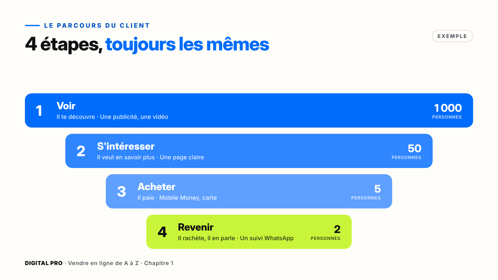
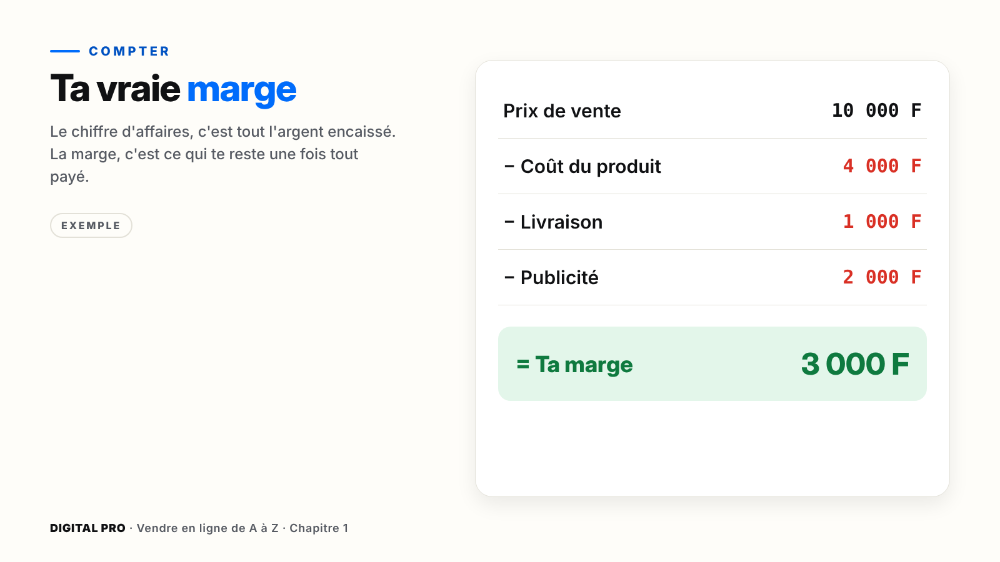
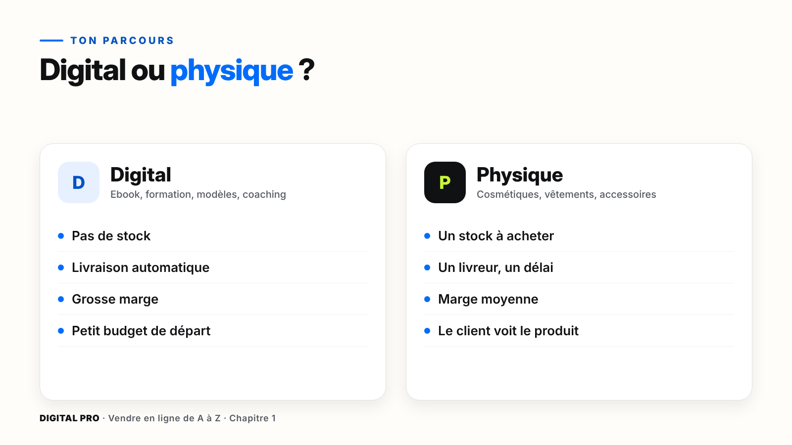
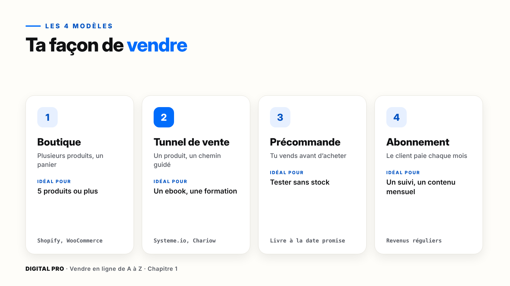
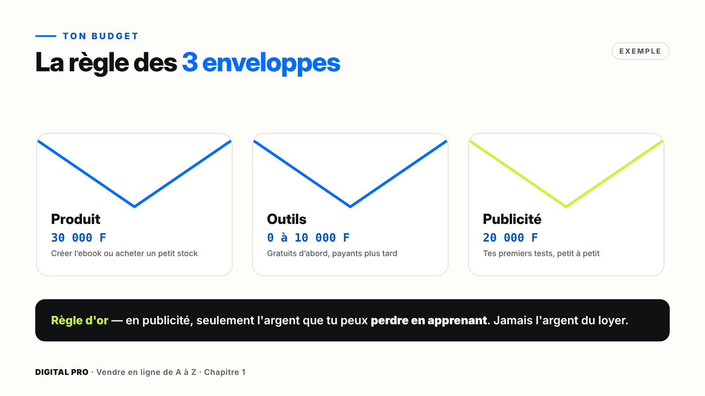

# Chapitre 1 — Les bases de la vente en ligne

`[PHOTO]` **Ouverture, pleine page** : une femme d'une trentaine d'années, dans un petit atelier lumineux, compare deux produits posés sur la table : un flacon de crème et un téléphone qui affiche la couverture d'un ebook. Elle a un carnet ouvert à côté d'elle. Lumière naturelle, ambiance concentrée.

> **La promesse de ce chapitre** : tu comprends comment un client achète, tu parles le langage du métier, et tu fais tes trois premiers choix : ton parcours, ton modèle de vente et ton budget. À la fin, tu sais exactement où tu vas.

---

## Ce que tu vas faire dans ce chapitre

- ☐ Comprendre les 4 étapes du parcours d'un client
- ☐ Connaître les 12 mots du métier
- ☐ Calculer la marge de ton futur produit
- ☐ Choisir ton parcours : digital ou physique
- ☐ Choisir ton modèle de vente
- ☐ Répartir ton budget en 3 enveloppes

**Ce qu'il te faut** : ta fiche « Mon projet » (parties 7 à 10), un stylo, et ton téléphone.

---

## 1.1 — Le parcours du client

Fatou fait défiler Facebook. Elle voit une vidéo sur une crème pour les mains. Elle clique, lit la page, regarde les avis. Elle paie par Mobile Money. Un mois plus tard, elle revient en racheter deux.

Fatou n'a pas acheté par hasard. Elle a suivi un **chemin**. Et tous tes clients suivront le même.

| Étape | Ce que vit le client | L'outil dont tu as besoin | Où tu l'apprends |
| --- | --- | --- | --- |
| **1. Voir** | Il te découvre | Une publicité, une vidéo | Modules 4, 7 à 11 |
| **2. S'intéresser** | Il veut en savoir plus | Une page claire et rassurante | Module 5 |
| **3. Acheter** | Il paie | Un paiement simple (Mobile Money, carte) | Module 6 |
| **4. Revenir** | Il rachète et parle de toi | Un suivi, par exemple sur WhatsApp | Modules 12 et 13 |

### Chaque étape perd du monde, et c'est normal

Exemple : 1 000 personnes voient ta publicité, 50 cliquent, 5 achètent, 2 reviennent. Ces chiffres ne sont pas une promesse : ils montrent seulement que **chaque étape filtre**. Si tu améliores une seule étape, toutes tes ventes montent.

> **À retenir** — Quand tu ne vends pas, ne te demande pas seulement « pourquoi ? ». Demande-toi : **à quelle étape je perds mes clients ?** Peu de clics : c'est la publicité. Des clics mais pas d'achat : c'est la page ou le paiement. Pas de retour : c'est le suivi.

### Pas à pas : dessine le parcours de ton client

**Marche 1 — Ouvre ta fiche « Mon projet », partie 7.**

**Marche 2 — Voir.** Écris où ton client passe du temps : Facebook, TikTok, WhatsApp, Google, LinkedIn ?
*Exemple* : « Mes clientes regardent des vidéos beauté sur TikTok le soir. »

**Marche 3 — S'intéresser.** Écris ce qui va l'attirer : un résultat, un prix, une démonstration ?
*Exemple* : « Voir une avant/après sur de vraies mains. »

**Marche 4 — Acheter.** Écris comment il préfère payer.
*Exemple* : « Orange Money ou Wave, ou paiement à la livraison. »

**Marche 5 — Revenir.** Écris pourquoi il reviendrait.
*Exemple* : « Le pot dure un mois : je relance après 30 jours. »

*Ce que tu dois voir* : 4 lignes remplies. Elles guideront tous les modules suivants.

---

## 1.2 — Les mots à connaître

Le e-commerce semble plein de mots compliqués. En vérité, **douze mots suffisent**. On les range en trois familles.

| Famille | Mot | Ce que ça veut dire, simplement |
| --- | --- | --- |
| **Pour vendre** | Produit | Ce que tu vends. |
| | Offre | Le produit + le prix + les petits bonus. Le client achète une offre, pas seulement un produit. |
| | Prix | Ce que le client paie. |
| | Page de vente | La page qui présente ton offre et fait acheter. |
| **Pour attirer** | Cible | Les personnes à qui tu parles. Pas tout le monde : les bonnes personnes. |
| | Publicité | Un message que tu paies pour être vu. |
| | Clic | Quand quelqu'un ouvre ta page. |
| | Prospect | Une personne intéressée, qui n'a pas encore acheté. |
| **Pour compter** | Chiffre d'affaires | Tout l'argent encaissé. |
| | Coûts | Tout ce que tu dépenses : produit, livraison, publicité, outils. |
| | Marge | Ce qui te reste vraiment, une fois tout payé. |
| | Taux de conversion | Sur 100 visiteurs, combien achètent (en %). |

### Pas à pas : calcule ta marge

**Marche 1** — Partie 8 de ta fiche, écris le **prix de vente** que tu imagines.
**Marche 2** — Écris le **coût du produit** (achat, fabrication, ou création pour un produit digital).
**Marche 3** — Écris la **livraison** (0 F pour un produit digital).
**Marche 4** — Estime la **publicité par vente**. Si tu ne sais pas, mets 20 % du prix : tu ajusteras après tes premiers tests.
**Marche 5** — Fais la soustraction : **prix − coûts = marge**.
*Ce que tu dois voir* : un nombre positif. S'il est négatif ou presque nul, ton prix est trop bas ou tes coûts trop hauts : on y reviendra au module 2.

> **Attention** — Beaucoup de vendeurs vendent beaucoup… et gagnent peu. Regarde toujours **ta marge**, pas seulement ton chiffre d'affaires.

> **Astuce** — Taux de conversion = acheteurs ÷ visiteurs. 100 visiteurs et 2 achats, c'est 2 %. Entre 1 et 3 %, c'est déjà un bon début.

---

## 1.3 — Digital ou physique : lequel pour toi ?

| | Produit digital | Produit physique |
| --- | --- | --- |
| **Exemples** | Ebook, formation, modèles, coaching en ligne | Cosmétiques, vêtements, accessoires, alimentaire |
| **Stock** | Aucun | À acheter et ranger |
| **Livraison** | Automatique, immédiate | Un livreur, un délai |
| **Marge** | Souvent très grande | Moyenne |
| **Confiance** | À construire (le client ne touche pas le produit) | Le client voit ce qu'il achète |
| **Budget de départ** | Petit | Plus grand, à cause du stock |

Aucun n'est meilleur. Le bon, c'est **celui qui te ressemble**.

### Pas à pas : le test en 4 questions

Réponds par **oui** ou par **non**, et coche dans la partie 9 de ta fiche.

1. Est-ce que tu sais faire quelque chose que d'autres veulent apprendre ? (une recette, un métier, une astuce)
2. Est-ce que tu as un budget pour acheter un petit stock ?
3. Est-ce que tu peux gérer des livraisons, toi-même ou avec un livreur ?
4. Est-ce que tu veux vendre même quand tu dors ?

| Tes « oui » | Ton parcours |
| --- | --- |
| Surtout aux questions 1 et 4 | **Parcours digital** |
| Surtout aux questions 2 et 3 | **Parcours physique** |
| Partout | Commence par un seul, ajoute l'autre plus tard |

> **Astuce** — Tu hésites encore ? Commence par le **digital**. Petit budget, pas de stock : c'est le meilleur terrain pour apprendre à vendre.

`[PHOTO]` Deux mains : l'une tient un téléphone affichant la couverture d'un ebook de recettes, l'autre tient un petit carton d'expédition avec une étiquette manuscrite.

---

## 1.4 — Les modèles qui marchent

| Modèle | Comment ça marche | Idéal pour | Outils typiques |
| --- | --- | --- | --- |
| **Boutique** | Plusieurs produits, un panier | 5 produits ou plus | Shopify, WooCommerce |
| **Tunnel de vente** | Un produit, un chemin guidé page après page | Un ebook, une formation, un produit phare | Systeme.io, Chariow |
| **Précommande** | Tu vends avant d'acheter le stock | Tester un produit physique sans risque | Une page + WhatsApp |
| **Abonnement** | Le client paie chaque mois | Un suivi, un contenu ou une box mensuelle | Systeme.io, Chariow |

### À quoi ressemble un tunnel de vente

1. **Page 1, l'offre** : un titre, un prix, un bouton « Je le veux ».
2. **Page 2, le paiement** : Mobile Money ou carte.
3. **Page 3, un bonus** : une petite offre proposée juste après l'achat (par exemple un pack complémentaire à moitié prix). Beaucoup de clients disent oui.
4. **Page 4, merci** : le produit est livré automatiquement par e-mail et WhatsApp.

`[CAPTURE]` Les 4 pages d'un tunnel côte à côte sur téléphone, reliées par des flèches bleues.

> **Astuce** — La **précommande**, c'est vendre avant d'acheter. Tu testes sans stock dormant. Une règle absolue : **livre toujours à la date promise**.

> **À retenir** — Commence avec **un seul modèle**. Quand il vend, tu pourras en ajouter un autre.

**Ton action** : partie 9 de ta fiche, coche ton modèle.

---

## 1.5 — Ton budget réaliste

Le vrai danger quand on démarre n'est pas de manquer d'argent. C'est de **tout dépenser d'un coup**, sur une seule idée.

### La règle des 3 enveloppes

| Enveloppe | À quoi elle sert | Exemple pour un petit départ |
| --- | --- | --- |
| **Produit** | Créer ton ebook ou acheter un petit stock | 30 000 F |
| **Outils** | Les versions gratuites d'abord, payantes plus tard | 0 à 10 000 F |
| **Publicité** | Tes premiers tests, en petits montants | 20 000 F |
| **Total** | | **50 000 à 60 000 F** |

Ces montants sont des **exemples**, pas une obligation : adapte-les à ta situation. Quand une enveloppe est vide, tu ne pioches pas dans les autres.

> **À retenir** — **Règle d'or** : ne mets en publicité que l'argent que tu peux **perdre en apprenant**. Jamais l'argent du loyer, de la nourriture ou de l'école.

### Monter par paliers

1. **Tester** : de petits montants, plusieurs essais.
2. **Valider** : les premières ventes arrivent.
3. **Augmenter** : tu réinvestis une partie de tes gains.

On augmente le budget **quand ça vend**, jamais avant.

### Pas à pas : remplis tes enveloppes

**Marche 1** — Reprends la somme de la partie 3 de ta fiche (ton budget de départ).
**Marche 2** — Partie 10, répartis-la entre Produit, Outils et Publicité.
**Marche 3** — Vérifie que le total ne dépasse pas ton budget de départ.
*Ce que tu dois voir* : 3 montants et un total. Si le total dépasse, réduis d'abord l'enveloppe Outils : presque tout peut commencer gratuitement.

---

## À retenir

1. Tout client suit **4 étapes** : voir, s'intéresser, acheter, revenir. Quand ça bloque, cherche l'étape qui bloque.
2. Ce qui compte, c'est **la marge**, pas seulement le chiffre d'affaires.
3. Un **parcours**, un **modèle**, un **budget en 3 enveloppes** : tu commences simple, et tu augmentes quand ça vend.

---

## Ta checklist du chapitre 1

Coche tout avant de passer au chapitre 2.

- ☐ Les **4 étapes** de mon client sont écrites (partie 7)
- ☐ Ma **marge** est calculée (partie 8)
- ☐ J'ai fait le **test en 4 questions** et choisi mon **parcours** (partie 9)
- ☐ J'ai choisi **un seul modèle de vente** (partie 9)
- ☐ Mon budget est réparti en **3 enveloppes** (partie 10)
- ☐ J'ai fait le **quiz du module 1**

**Tout est coché ?** Bravo, tes bases sont posées. Rendez-vous au chapitre 2 : trouver et valider ton produit.
