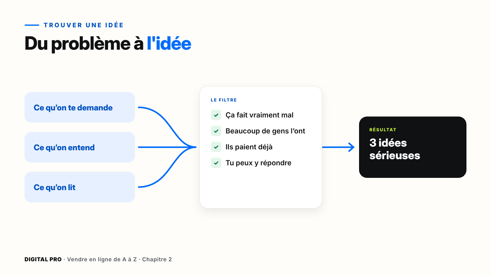
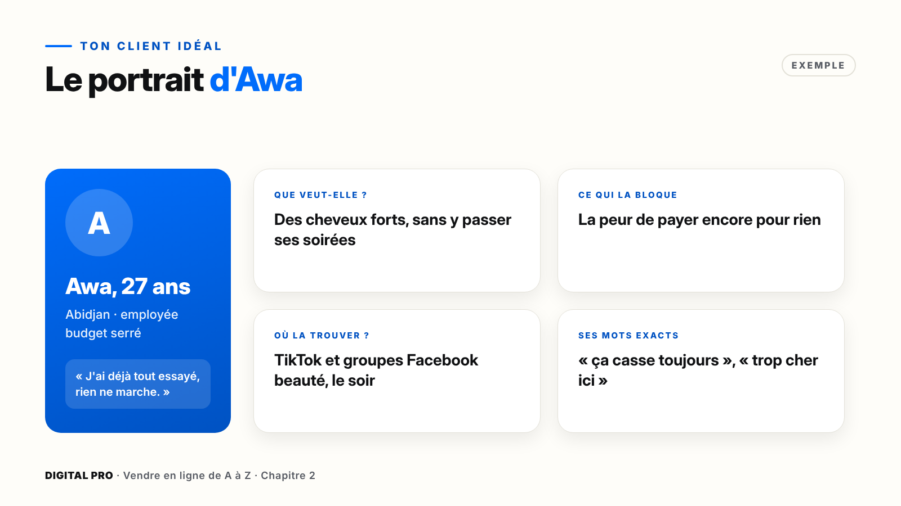
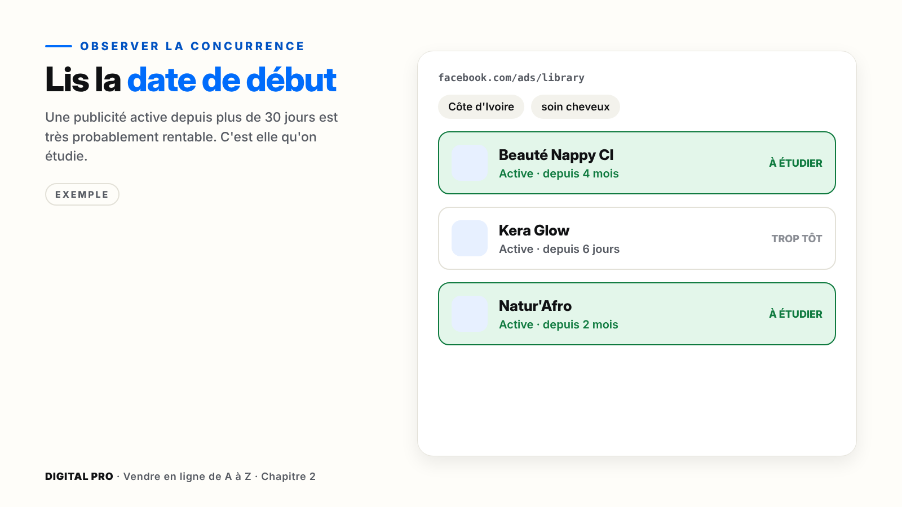
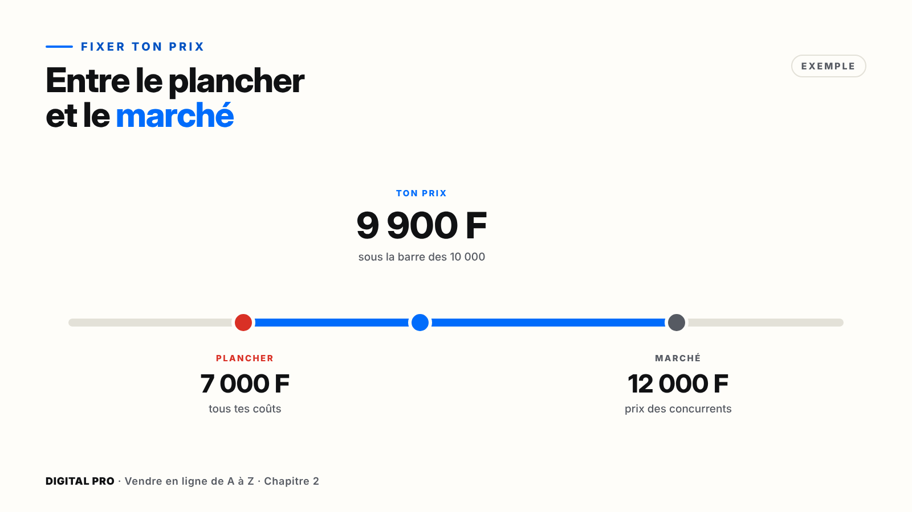
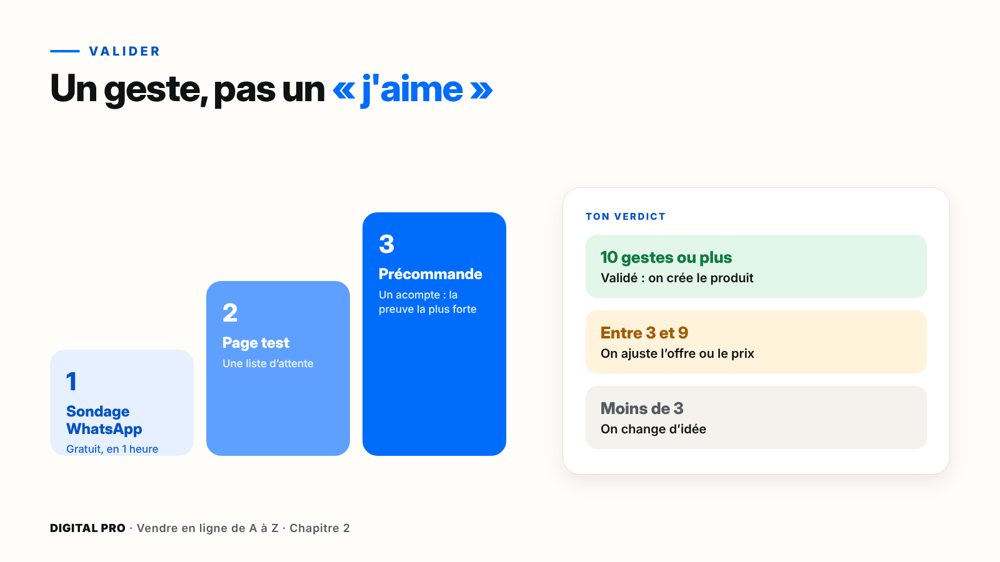

# Chapitre 2 — Trouver et valider ton produit

`[PHOTO]` **Ouverture, pleine page** : un jeune homme assis sur un banc dans un marché animé. Il tient son téléphone d'une main et note quelque chose dans un carnet de l'autre. Autour de lui, des étals flous. Ambiance attentive, curieuse, lumière de fin d'après-midi.

> **La promesse de ce chapitre** : à la fin, tu as un produit que des gens veulent **vraiment**, un prix juste, et la preuve que ça se vend, avant d'avoir dépensé ton argent pour le créer.

---

## Ce que tu vas faire dans ce chapitre

- ☐ Noter 10 vrais problèmes et garder les 3 meilleures idées
- ☐ Dessiner le portrait de ton client idéal et interroger 3 personnes
- ☐ Étudier 5 publicités concurrentes qui marchent
- ☐ Fixer ton prix
- ☐ Obtenir 10 gestes de validation

**Ce qu'il te faut** : ton téléphone, WhatsApp, Facebook, et ta fiche « Mon projet » (parties 11 à 15). Compte quelques jours pour la validation : c'est normal.

---

## 2.1 — Trouver des idées à partir de vrais problèmes

Les gens n'achètent pas un produit. Ils achètent **la solution à un problème**. Alors on ne commence pas par chercher un produit : on cherche un problème.

### Les 3 sources de problèmes

| Source | Ce que tu cherches | Exemple |
| --- | --- | --- |
| **Ce qu'on te demande** | Les questions qu'on te pose souvent | « Tu peux m'aider à faire mon CV ? » |
| **Ce qu'on entend** | Les plaintes autour de toi | « J'en ai marre, mes cheveux cassent. » |
| **Ce qu'on lit** | Commentaires, groupes, avis en ligne | « Quelqu'un a une solution ? » sous une publication |

### Pas à pas : la chasse aux problèmes dans les commentaires

**Marche 1 — Cherche ton sujet.** Dans Facebook, tape ton thème (par exemple « cheveux crépus ») et ouvre l'onglet **Groupes**.
**Marche 2 — Ouvre les commentaires.** Pas les publications : les commentaires. C'est là que les gens disent ce qui les fait souffrir.
**Marche 3 — Note chaque problème** dans la partie 11 de ta fiche, et **combien de fois** tu le vois revenir.
*Ce que tu dois voir* : une liste de 10 problèmes, avec un chiffre à côté de chacun. Celui qui revient le plus est une piste sérieuse.

### Le filtre des 4 tests

Une bonne idée passe ces quatre tests :

1. **Le problème fait vraiment mal** : on en parle souvent, avec émotion.
2. **Beaucoup de gens l'ont** : pas seulement toi et ta cousine.
3. **Ils paient déjà pour le régler** : il existe des produits, même imparfaits.
4. **Tu peux y répondre** : avec ton savoir, ou avec un fournisseur.

> **Astuce** — La concurrence n'est pas une mauvaise nouvelle : elle prouve que les gens achètent. Pas de concurrent du tout ? Souvent, **pas de marché**.

| Le problème | L'idée de produit | Parcours |
| --- | --- | --- |
| Cheveux qui cassent | Guide « Routine cheveux crépus en 7 jours » | Digital |
| Produits trop chers | Kit de soins maison à petit prix | Physique |
| Pas le temps de se coiffer | Tutoriels vidéo de coiffures en 10 min | Digital |

**Ton action** : passe tes 10 problèmes au filtre, et garde tes **3 meilleures idées**.

---

## 2.2 — Ton client idéal

Quand on parle à tout le monde, on ne parle à personne. Ta publicité doit donner l'impression d'avoir été écrite pour **une seule personne**. On va la dessiner.

### Le portrait en 4 questions

| Question | Ce que tu écris | Exemple : Awa |
| --- | --- | --- |
| **Qui est-il ?** | Âge, ville, métier, budget | 27 ans, Abidjan, employée, budget serré |
| **Que veut-il ?** | Le résultat rêvé, pas le produit | Des cheveux forts, sans y passer ses soirées |
| **Qu'est-ce qui le bloque ?** | Ses peurs, ses doutes | « J'ai déjà tout essayé, rien ne marche. » |
| **Où le trouver ?** | Réseaux, groupes, heures | TikTok et groupes Facebook beauté, le soir |

> **Astuce** — Note les **mots exacts** de ton client, pas les tiens. « J'ai déjà tout essayé » deviendra peut-être le titre de ta future publicité.

### Pas à pas : interroge 3 vraies personnes

**Marche 1** — Choisis **3 personnes** qui ressemblent à ton client idéal.
**Marche 2** — Envoie-leur ce message sur WhatsApp (adapte le sujet) :

> « Salut ! Je prépare un projet sur [ton sujet]. 3 petites questions ? 1. Quel est ton plus gros souci avec [ton sujet] ? 2. Qu'as-tu déjà essayé ? 3. Qu'est-ce qui t'a déçu ? »

**Marche 3** — Note leurs réponses **mot pour mot** dans la partie 12 de ta fiche.

> **Attention** — Ne demande jamais « Tu achèterais mon produit ? ». Les gens disent oui pour être gentils. Demande ce qu'ils ont **déjà fait** et **déjà payé** : le passé ne ment pas.

---

## 2.3 — Observer la concurrence, en toute légalité

Les publicités de tes concurrents sont **publiques**. Meta, TikTok et Google les montrent gratuitement, par transparence. Profitons-en.

| Plateforme | Outil gratuit | Ce qu'il montre |
| --- | --- | --- |
| Facebook et Instagram | **Bibliothèque publicitaire Meta** (facebook.com/ads/library) | Les publicités actives, avec leur date de début |
| TikTok | **TikTok Creative Center** | Les publicités qui marchent le mieux |
| Google et YouTube | **Centre de transparence des annonces Google** | Les annonces d'un annonceur |

### Pas à pas : la Bibliothèque publicitaire Meta

**Marche 1** — Dans ton navigateur, ouvre **facebook.com/ads/library**.
**Marche 2** — Choisis ton **pays** (par exemple Côte d'Ivoire) et la catégorie « Toutes les publicités ».
**Marche 3** — Tape ton **mot-clé** (par exemple « soin cheveux ») et lance la recherche.
**Marche 4** — Regarde la **date de début** de chaque publicité.
*Ce que tu dois voir* : des publicités avec la mention « Active » et une date. Celles qui tournent depuis des mois sont celles qui rapportent.

> **À retenir** — Une publicité active depuis **plus de 30 jours** est très probablement rentable. C'est elle qu'on étudie.

### Ta grille d'observation

Pour chaque publicité qui marche, note dans la partie 13 de ta fiche :

- **L'accroche** : la première phrase, les 3 premières secondes.
- **L'offre** : prix, bonus, garantie, livraison.
- **Le format** : vidéo, photo, témoignage, avant/après.
- **Les commentaires** : ce que les clients demandent et ce dont ils se plaignent. Ce sont des trous que tu peux combler.

> **À éviter** — S'inspirer, oui. **Copier, non.** Ne reprends jamais les photos, vidéos ou textes d'un autre vendeur : c'est interdit, et ta publicité peut être refusée ou ton compte bloqué.

---

## 2.4 — Fixer ton prix

Le prix le plus bas n'est pas une stratégie. Il attire les clients les plus difficiles, et il tue ta marge.

### La méthode en 3 étapes

1. **Le plancher** : la somme de tous tes coûts. En dessous, tu perds de l'argent.
2. **Le marché** : les prix de tes concurrents (relevés à la leçon 2.3).
3. **Le bon chiffre** : un prix psychologique, entre ton plancher et le marché.

| Exemple : un kit de soins | Montant |
| --- | --- |
| Produits et flacons | 3 500 F |
| Emballage | 500 F |
| Livraison offerte | 1 000 F |
| Publicité par vente | 2 000 F |
| **Plancher** | **7 000 F** |
| Prix des concurrents | environ 12 000 F |
| **Prix choisi** | **9 900 F**, soit 2 900 F de marge par vente |

### 3 astuces de prix psychologique en FCFA

- **Sous la barre** : 9 900 F se lit « neuf mille quelque chose », 10 000 F se lit « dix mille ».
- **Le pack** : 1 pour 5 000 F, 3 pour 12 500 F. Le client gagne, et toi tu vends plus.
- **L'ancre** : montre d'abord la valeur (par exemple le prix d'un passage au salon), puis ton prix.

> **Attention** — Un prix reste **honnête**. Ne barre jamais un faux « ancien prix » qui n'a jamais existé.

**Ton action** : partie 14 de ta fiche, calcule ton plancher, relève 3 prix concurrents et choisis ton prix.

---

## 2.5 — Valider avant de créer

Des « j'aime » et des « trop bien », ce n'est pas une validation. Une validation, c'est **un geste** : quelqu'un t'écrit, s'inscrit ou paie. Objectif : **10 gestes** de ta cible.

| Méthode | Effort | Force de la preuve |
| --- | --- | --- |
| **Sondage WhatsApp** | Gratuit, 1 heure | Moyenne, si tu relances chaque « oui » en privé |
| **Page test** | Une page simple avec une liste d'attente | Bonne : la personne laisse son contact |
| **Précommande** | Une offre, une date, un petit acompte | La plus forte : la personne paie |

### Pas à pas : le sondage WhatsApp

**Marche 1** — Ouvre ton groupe WhatsApp (ou une discussion).
**Marche 2** — Appuie sur la **pièce jointe**, puis **Sondage**.
**Marche 3** — Écris une question qui parle du problème, par exemple : « Une routine pour cheveux qui cassent, ça t'intéresse ? »
**Marche 4** — Propose 3 réponses : « Oui, je la veux dès qu'elle sort », « Peut-être, dis-m'en plus », « Non merci ». Envoie.
**Marche 5** — Écris **en privé** à chaque personne qui a dit oui : « Je te garde une place ? ».
*Ce que tu dois voir* : des réponses privées. Une réponse privée vaut dix votes.

### Pas à pas : la précommande honnête

1. Présente ton offre dans une page ou un message.
2. Donne un **prix de lancement** et une **date de livraison précise**.
3. Demande un **petit acompte** par Mobile Money.
4. Promets le **remboursement** si tu ne livres pas, et tiens parole.

### Le verdict

| Résultat | Décision |
| --- | --- |
| **10 gestes ou plus** | Validé : on crée le produit (chapitre 3) |
| **Entre 3 et 9** | On ajuste l'offre ou le prix, et on reteste |
| **Moins de 3** | On change d'idée. Ce n'est pas un échec : tu viens d'économiser des semaines et de l'argent |

---

## À retenir

1. On vend **une solution à un problème**, trouvé dans ce qu'on te demande, ce qu'on entend et ce qu'on lit.
2. Un client idéal, c'est **une seule personne**, avec ses mots exacts.
3. Une publicité active depuis **plus de 30 jours** est probablement rentable : on s'en inspire, on ne la copie jamais.
4. Ton prix se place **entre ton plancher et le marché**, et reste honnête.
5. Une validation, c'est **10 gestes**, pas des « j'aime ».

---

## Ta checklist du chapitre 2

- ☐ 10 problèmes notés, 3 idées gardées (partie 11)
- ☐ Le portrait de mon client idéal, avec les mots de 3 vraies personnes (partie 12)
- ☐ 5 publicités concurrentes étudiées avec la grille (partie 13)
- ☐ Mon prix est fixé (partie 14)
- ☐ Ma validation est lancée, et je compte mes gestes (partie 15)
- ☐ J'ai fait le quiz du module 2

**10 gestes obtenus ?** Bravo, ton produit est validé. Rendez-vous au chapitre 3 pour le créer : 3A si tu es en parcours digital, 3B si tu es en parcours physique.
