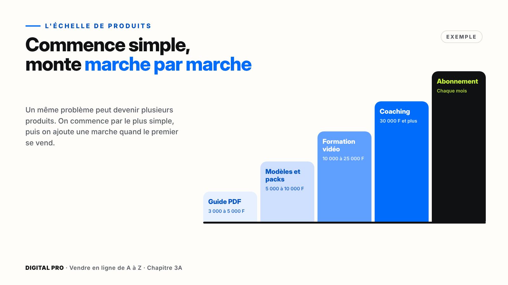
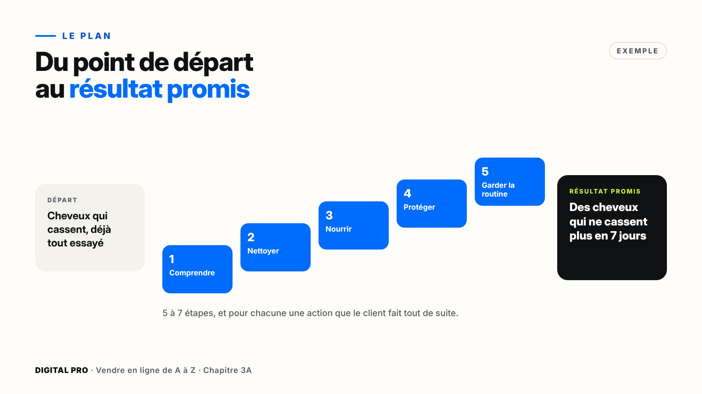
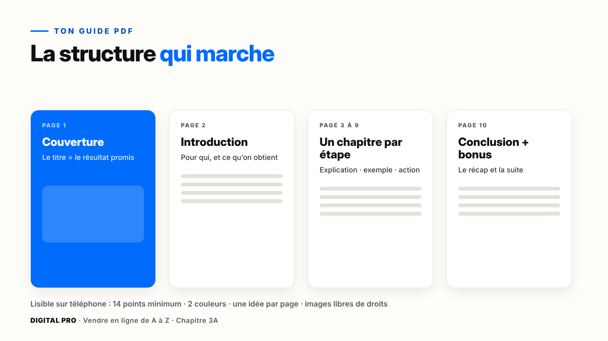
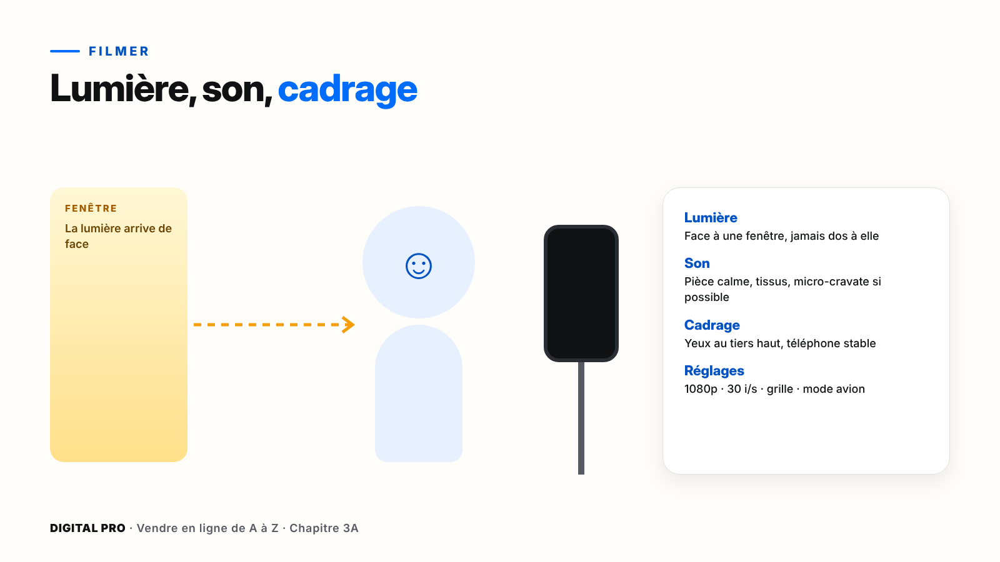
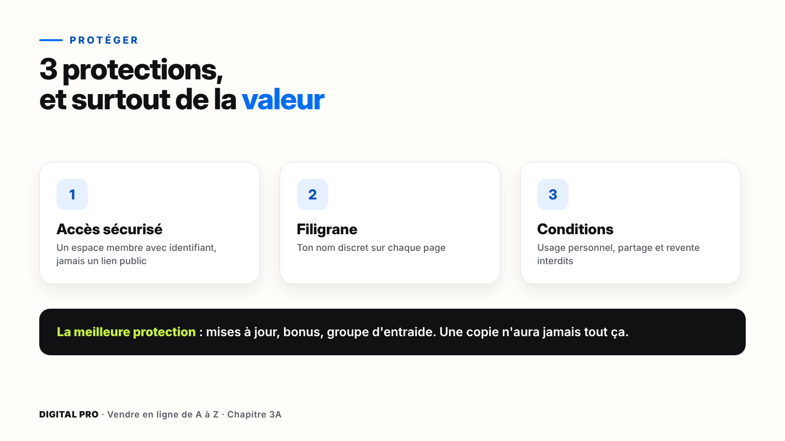

# Chapitre 3A — Créer ton produit digital

*Parcours digital. Si tu as choisi le parcours physique, passe directement au chapitre 3B.*

`[PHOTO]` **Ouverture, pleine page** : une jeune femme assise à une table, face à une fenêtre lumineuse. Son téléphone est posé sur un petit trépied devant elle ; elle parle en souriant, un micro-cravate accroché au col. Sur la table : un carnet avec un plan écrit à la main.

> **La promesse de ce chapitre** : à la fin, ton produit digital existe en version 1, il est protégé, et il a été testé par trois personnes de ta cible. Avec ton téléphone et des outils gratuits ou peu chers.

---

## Ce que tu vas faire dans ce chapitre

- ☐ Choisir le format de ton premier produit
- ☐ Écrire ton résultat promis et le plan en 5 à 7 étapes
- ☐ Créer ton guide dans Canva (ou filmer et monter tes vidéos)
- ☐ Préparer un modèle ou un pack si c'est ton format
- ☐ Cadrer ton offre de coaching si c'est ton format
- ☐ Protéger ton produit et le faire tester par 3 personnes

**Ce qu'il te faut** : ton téléphone, Canva, CapCut si tu fais de la vidéo, ta fiche « Mon projet » (partie 16).

---

## 3A.1 — Les 6 produits digitaux qui se vendent

| Format | Ce que c'est | Effort de création | Prix indicatif |
| --- | --- | --- | --- |
| **Guide PDF** | Un document clair qui mène à un résultat | Faible | 3 000 à 5 000 F |
| **Modèles** | CV, menus, plannings, visuels prêts à modifier | Faible | 3 000 à 10 000 F |
| **Fiches et packs** | Checklists, recettes, exercices regroupés | Faible | 3 000 à 10 000 F |
| **Formation vidéo** | Tu montres, ils reproduisent | Moyen | 10 000 à 25 000 F |
| **Coaching** | Ton temps, en direct | Faible à créer, fort à livrer | 30 000 F et plus |
| **Abonnement** | Un contenu nouveau chaque mois | Continu | Chaque mois |

*Les prix sont des repères, pas des règles : ton marché et ta leçon 2.4 décident.*

> **Astuce** — Commence par le format **le plus simple**, souvent un guide PDF. Quand il se vend, transforme-le en formation vidéo, puis en coaching : c'est ton **échelle de produits**.

---

## 3A.2 — Le plan de ton produit

Ton client ne veut pas cinquante pages ni dix heures de vidéo. Il veut **un résultat**. Alors on construit le plan en partant de la fin.

### La méthode du résultat promis

1. **Le résultat promis**, en une phrase : « Des cheveux qui ne cassent plus, en 7 jours. »
2. **Le point de départ** de ton client : où en est-il aujourd'hui ?
3. **5 à 7 étapes** entre les deux. Pas plus.
4. **Une action** concrète par étape.

| Étape | Action du client |
| --- | --- |
| 1. Comprendre pourquoi ça casse | Faire le test du cheveu |
| 2. Nettoyer en douceur | Préparer le shampoing maison |
| 3. Nourrir | Appliquer le masque du jour 3 |
| 4. Protéger la nuit | Mettre en place le foulard en satin |
| 5. Garder la routine | Remplir le calendrier des 7 jours |

> **Astuce IA** — Donne à une IA ton résultat promis et le portrait de ton client, puis demande : « Propose-moi 7 étapes, avec une action concrète pour chacune. » Garde ce qui est juste, **corrige avec ton expérience**. L'IA propose, c'est toi qui décides.

---

## 3A.3 — Ton guide PDF avec Canva

### Pas à pas : crée ton guide

**Marche 1** — Ouvre Canva et tape **« Ebook »** dans la recherche.
**Marche 2** — Choisis un modèle **sobre et lisible**. Un modèle gratuit suffit.
**Marche 3** — Page 1 : la **couverture**, avec ton résultat promis en titre.
**Marche 4** — Page 2 : l'**introduction** (pour qui, et ce qu'on va obtenir).
**Marche 5** — Une page ou plus **par étape** de ton plan : explication, exemple, action.
**Marche 6** — Dernière page : **conclusion** et petit bonus.
**Marche 7** — **Partager** › **Télécharger** › **PDF Standard**.
*Ce que tu dois voir* : un PDF qui s'ouvre bien sur ton téléphone, sans zoomer.

**Les règles de lisibilité** : texte de **14 points minimum**, **2 couleurs** (une principale, une d'accent), **une idée par page**, des listes courtes.

> **Attention** — Uniquement des images **libres de droits** : celles de Canva ou tes propres photos. Jamais une image copiée sur Google.

---

## 3A.4 — Filmer ta formation avec ton téléphone

Pas besoin de caméra : ton téléphone suffit. Mais retiens ceci : **on pardonne une image moyenne, pas un mauvais son**.

### Pas à pas : prépare ton tournage

**Marche 1 — La lumière.** Mets-toi face à une fenêtre, jamais dos à elle.
**Marche 2 — Le son.** Une pièce calme, avec des rideaux ou des tissus. Un petit micro-cravate améliore beaucoup le son.
**Marche 3 — Le cadrage.** Tes yeux au tiers haut de l'image, le téléphone stable (trépied ou pile de livres).
**Marche 4 — Les réglages.** Nettoie l'objectif, active la **grille**, choisis **1080p à 30 images par seconde**, passe en **mode avion**.
**Marche 5 — Filme en séquences** de 2 à 5 minutes. Une erreur ? Tu ne refais que la séquence.
*Ce que tu dois voir* : une séquence test d'une minute, au son clair quand tu la réécoutes avec des écouteurs.

---

## 3A.5 — Monter avec CapCut

Un montage de formation tient en **4 gestes** : couper, titrer, sous-titrer, exporter.

### Pas à pas : ton premier montage

**Marche 1** — Ouvre CapCut, **Nouveau projet**, choisis ta séquence.
**Marche 2** — Pour couper une erreur : place la ligne blanche au début, **Diviser** ; pareil à la fin ; sélectionne le morceau, **Supprimer**.
**Marche 3** — **Texte** › **Sous-titres automatiques**, en français. **Relis et corrige** les mots mal compris.
**Marche 4** — **Exporter** en 1080p.
*Si ça bloque* : selon la version de l'application, certaines options peuvent être payantes. Les gestes de base (couper, texte, exporter) restent disponibles.

> **Attention** — Pour un produit que tu vends : **pas de musique protégée**. Utilise la bibliothèque libre de l'application, ou pas de musique.

> **Astuce** — Crée une fois pour toutes un **début** et une **fin** identiques pour toutes tes vidéos : ta formation paraît tout de suite professionnelle.

---

## 3A.6 — Modèles, fiches, packs

Les gens ne paient pas seulement pour apprendre : ils paient pour **gagner du temps**.

| Pour qui | Idée de produit |
| --- | --- |
| Restaurants | Pack de 20 menus modifiables |
| Chercheurs d'emploi | 5 modèles de CV + lettres |
| Commerçants | 30 visuels promo pour les réseaux |
| Familles | Planning de repas de la semaine + liste de courses |

### Pas à pas : vendre un modèle Canva

**Marche 1** — Dans ton design : **Partager** › **Lien du modèle**.
**Marche 2** — Copie le lien : chaque personne qui l'ouvre reçoit **sa propre copie**, ton original reste intact.
**Marche 3** — Place ce lien dans un petit **PDF de livraison**, avec un mot de remerciement. C'est ce PDF que tu vends.
*Si ça bloque* : selon ton compte, cette option peut demander Canva Pro. Vérifie avant de lancer ton offre.

> **Astuce** — Un **pack** (10 modèles + un mini-guide d'utilisation) se vend mieux qu'un modèle seul, pour le même travail de vente.

---

## 3A.7 — Coaching et accompagnement

Le coaching se vend cher, mais ton temps est limité. On le vend donc en **formules**.

| Formule | Format | Pour qui |
| --- | --- | --- |
| **Séance unique** | 1 heure pour débloquer un problème précis | Les clients pressés |
| **Programme** | 4 semaines, 1 séance par semaine + exercices | Ceux qui veulent un vrai résultat |
| **Groupe** | 5 à 10 personnes en même temps | Prix plus bas pour eux, plus rentable pour toi |

**Avant la première séance**, écris : le résultat promis, le cadre (nombre de séances, durée, outil comme WhatsApp ou Google Meet), le **paiement avant la séance** par Mobile Money, et une règle d'annulation (prévenir 24 h avant).

> **Astuce** — Note les questions qui reviennent dans tes séances : ce sont tes prochains guides et ta future formation.

---

## 3A.8 — Protéger ton produit

Aucun produit digital n'est protégé à 100 %. Mais tu peux rendre le partage difficile et peu intéressant.

| À éviter | À faire |
| --- | --- |
| Envoyer le PDF à la main par WhatsApp | Un lien de téléchargement personnel |
| Des vidéos en lien public | Un espace membre avec identifiant (Systeme.io, Chariow…) |
| Aucune mention légale | Des conditions d'utilisation acceptées à l'achat |

**Modèle de conditions d'utilisation (à adapter)** :

> « Ce produit est destiné à un usage personnel. Il est interdit de le copier, de le partager, de le revendre ou de le diffuser, en tout ou en partie, sans autorisation écrite. »

> **À retenir** — La meilleure protection, c'est **la valeur** : mises à jour, bonus, groupe d'entraide. Une copie n'aura jamais tout ça.

### Le test final

Donne ton produit à **3 personnes de ta cible**. Demande-leur : « Qu'est-ce qui était difficile ? Qu'est-ce qui manquait ? » Corrige, et note tout dans la partie 16 de ta fiche.

---

## À retenir

1. Commence par **le format le plus simple**, puis monte l'échelle de produits.
2. On vend **un résultat** : 5 à 7 étapes, une action par étape.
3. Lisibilité sur téléphone, **son clair**, images et musiques **libres de droits**.
4. Protège ton produit, et surtout donne **plus de valeur** qu'une copie.

---

## Ta checklist du chapitre 3A

- ☐ Mon format est choisi
- ☐ Mon résultat promis et mes étapes sont écrits
- ☐ Mon produit version 1 est créé (guide, vidéos, modèles ou offre de coaching)
- ☐ Filigrane et conditions d'utilisation en place
- ☐ 3 personnes ont testé, j'ai corrigé
- ☐ J'ai fait le quiz du module 3A

**Tout est coché ?** Ton produit digital existe. Rendez-vous au chapitre 4 : le message qui fait vendre.
