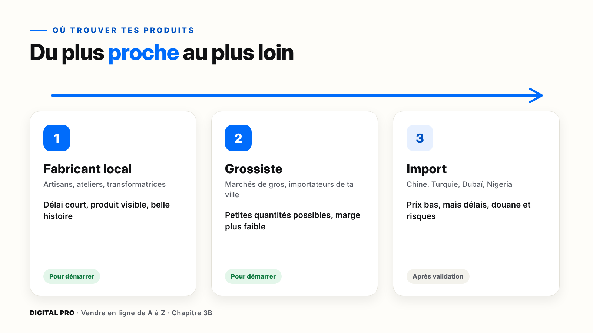
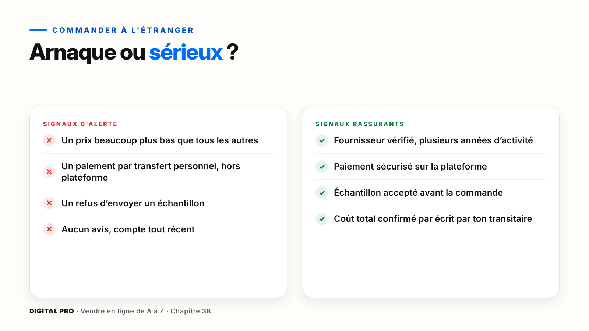
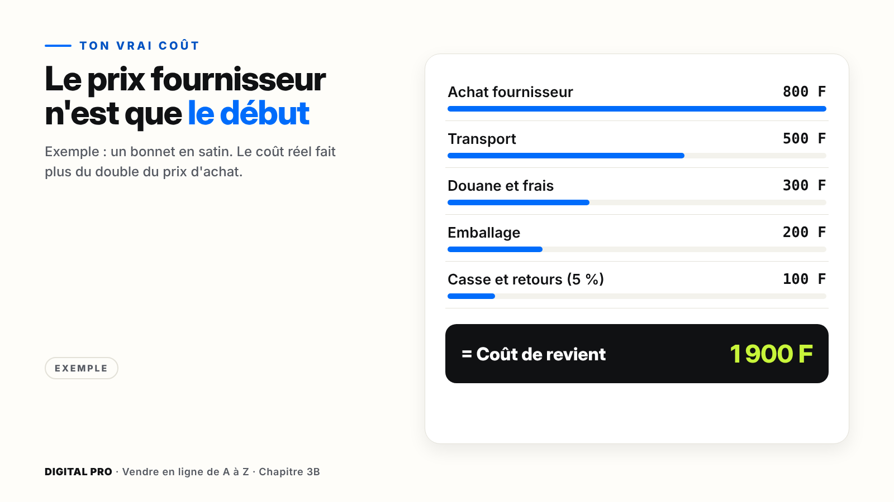
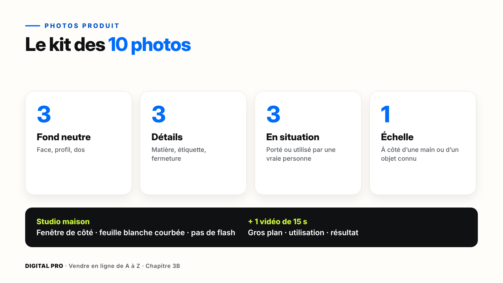
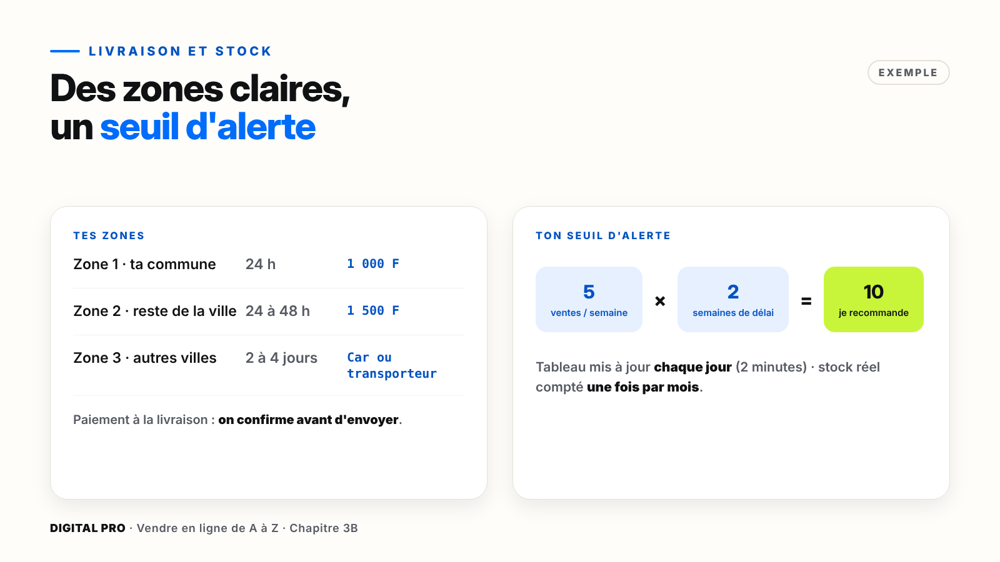

# Chapitre 3B — Lancer ton produit physique

*Parcours physique. Si tu as choisi le parcours digital, ce chapitre est facultatif : passe au chapitre 4.*

`[PHOTO]` **Ouverture, pleine page** : un petit espace de travail rangé, près d'une fenêtre. Sur une table : quelques produits alignés (flacons, bonnets en satin), une feuille blanche courbée contre le mur qui sert de fond photo, un téléphone sur un petit trépied, et un cahier ouvert sur un tableau de stock écrit à la main.

> **La promesse de ce chapitre** : tu as un fournisseur fiable, un échantillon validé, ton vrai coût et ta marge, dix photos qui vendent, une livraison organisée et un stock sous contrôle. Sans prendre de risque inutile.

---

## Ce que tu vas faire dans ce chapitre

- ☐ Trouver 3 fournisseurs et leur poser les 5 questions
- ☐ Savoir commander à l'étranger sans te faire arnaquer
- ☐ Choisir entre stock, dropshipping local et précommande
- ☐ Commander et contrôler ton échantillon
- ☐ Calculer ton vrai coût par pièce, et ta marge
- ☐ Faire tes 10 photos et ta vidéo de 15 secondes
- ☐ Organiser ta livraison par zones
- ☐ Créer ton tableau de stock et ton seuil d'alerte

**Ce qu'il te faut** : ton téléphone, une feuille blanche, un cahier ou Google Sheets, et ta fiche « Mon projet » (partie 17).

---

## 3B.1 — Où trouver tes produits

| Source | Exemples | Ce qu'il faut savoir |
| --- | --- | --- |
| **Fabricant local** | Artisans, ateliers, transformatrices de karité ou de jus | Délai court, tu vois le produit, belle histoire à raconter |
| **Grossiste** | Marchés de gros, importateurs de ta ville | Petites quantités possibles, mais marge plus faible |
| **Import** | Chine, Turquie, Dubaï, pays voisins comme le Nigeria | Prix bas, mais délais, douane et plus de risques |

> **Astuce** — Pour ta première commande, commence **au plus près** : un fabricant local ou un grossiste. L'import viendra quand tes ventes seront validées.

### Pas à pas : interroge 3 fournisseurs

Pose ces **5 questions** à chacun, et note les réponses dans la partie 17 de ta fiche :

1. Quelle est la **quantité minimum** ?
2. Quel est le **prix selon la quantité** ?
3. Quel est le **délai de livraison** ?
4. Puis-je avoir un **échantillon** ?
5. Pouvez-vous me **réapprovisionner rapidement** si ça se vend bien ?

*Ce que tu dois voir* : un tableau rempli, qui te permet de comparer les trois en un coup d'œil.

---

## 3B.2 — Commander à l'étranger sans se faire arnaquer

| Acteur | Son rôle |
| --- | --- |
| **Alibaba** | Fournisseurs chinois qui vendent à l'international |
| **1688** | Le marché intérieur chinois : prix plus bas, mais il faut passer par un **agent** |
| **Transitaire** | Récupère ta marchandise en Chine, la transporte et s'occupe de la douane jusqu'à chez toi |

### Pas à pas : trier les fournisseurs sur Alibaba

**Marche 1** — Cherche ton produit, en anglais si possible.
**Marche 2** — Active le filtre des **fournisseurs vérifiés** et choisis ceux qui ont plusieurs années d'activité.
**Marche 3** — Compare les fiches : années d'activité, taux de réponse, avis des clients.
**Marche 4** — Contacte au moins **3 fournisseurs** avec le même message : quantité, prix, échantillon, délai.
*Si ça bloque* : l'interface change souvent. Cherche les mots « Verified », « Years », « Response rate ».

> **Attention** — Avant de payer le fournisseur, demande à ton transitaire **le coût total jusqu'à chez toi, douane comprise, par écrit**. Sinon, un produit pas cher peut devenir très cher à l'arrivée.

---

## 3B.3 — Stock, dropshipping local ou précommande

| Modèle | Comment ça marche | Pour qui |
| --- | --- | --- |
| **Stock** | Tu achètes à l'avance et tu ranges chez toi | Un produit validé, qui se vend régulièrement |
| **Dropshipping local** | Un fournisseur de ta ville garde le stock et livre à ta place ; tu prends une commission | Un grossiste fiable près de chez toi, qui accepte de livrer |
| **Précommande** | Tu vends d'abord, tu achètes ensuite | Petit budget, produit à tester |

> **Attention** — En dropshipping, si le fournisseur livre en retard ou livre un mauvais produit, **c'est toi que le client tient pour responsable**. Teste toi-même la qualité et le délai avant de vendre.

> **À retenir** — Le chemin le plus sûr : **précommande** pour tester, puis **petit stock**, puis on augmente quand ça vend.

---

## 3B.4 — Commander et vérifier tes échantillons

**Règle d'or** : jamais de grosse commande sans avoir tenu l'échantillon dans tes mains. Même si le fournisseur est sympathique.

### Pas à pas : contrôle ton échantillon

**Marche 1 — Conforme ?** Couleur, taille, finitions : est-ce comme sur les photos ?
**Marche 2 — Solide ?** Coutures, fermetures, emballage.
**Marche 3 — Étiqueté ?** Composition, date, mode d'emploi. Pour les **cosmétiques et l'alimentaire**, c'est indispensable.
**Marche 4 — Validé ?** Montre-le à **3 personnes de ta cible** : l'achèteraient-elles ?

> **Astuce** — Filme l'ouverture du colis et prends tes premières photos tout de suite : tu les réutiliseras dans tes publicités.

| Résultat | Ta décision |
| --- | --- |
| Tout est conforme | Petite première commande |
| Petits défauts | Demande une correction et un nouvel échantillon |
| Gros défauts | Change de fournisseur, sans regret |

---

## 3B.5 — Ton vrai coût

Le prix du fournisseur n'est pas ton coût : c'est seulement le début. Beaucoup de vendeurs perdent de l'argent sans le savoir, parce qu'ils oublient des frais.

| Poste (exemple : un bonnet en satin) | Par pièce |
| --- | --- |
| Achat fournisseur | 800 F |
| Transport jusqu'à chez toi | 500 F |
| Douane et frais de dossier | 300 F |
| Emballage | 200 F |
| Casse et retours (environ 5 %) | 100 F |
| **Coût de revient** | **1 900 F** |
| + Livraison client (si offerte) | 1 000 F |
| + Publicité par vente | 1 500 F |
| Prix de vente | 6 500 F |
| **Marge par pièce** | **2 100 F** |

*Ces chiffres sont un exemple : remplace-les par les tiens.*

> **Attention** — Les taux de douane changent selon ton pays et selon le produit. **Demande-les par écrit** à ton transitaire, avant de commander.

---

## 3B.6 — Des photos et vidéos qui vendent

En ligne, le client ne peut pas toucher ton produit : il le regarde. Tes photos font le travail du vendeur.

### Pas à pas : ton studio maison

**Marche 1** — Place-toi **près d'une fenêtre**, lumière de côté. **Pas de flash.**
**Marche 2** — Pose une grande **feuille blanche** courbée contre le mur : plus de coin visible.
**Marche 3** — Appuie sur le produit à l'écran pour faire la **mise au point** ; glisse vers le bas si l'image est trop claire.
**Marche 4** — Fais tes **10 photos** : 3 fond neutre (face, profil, dos), 3 détails, 3 en situation, 1 pour l'échelle.
**Marche 5** — Filme **15 secondes** : gros plan, utilisation, résultat.
**Marche 6** — Range tout dans ton dossier **1 - PRODUIT**.

> **À éviter** — Utiliser seulement les photos du fournisseur : tes concurrents ont les mêmes. Tes propres photos rassurent et te distinguent.

---

## 3B.7 — Organiser la livraison

| Option | Avantages | Limites |
| --- | --- | --- |
| **Livreur indépendant** (souvent à moto) | Souple, prix négociable | Fiabilité à vérifier |
| **Société de livraison** | Suivi des colis, plus fiable | Plus cher |
| **Point de retrait** | Pas de frais de course | Le client doit se déplacer |

| Zone (exemple) | Délai | Prix |
| --- | --- | --- |
| Zone 1 · ta commune | 24 h | 1 000 F |
| Zone 2 · reste de la ville | 24 à 48 h | 1 500 F |
| Zone 3 · autres villes | 2 à 4 jours | Car ou transporteur |

> **Attention** — Le paiement à la livraison rassure, mais crée des refus. **Confirme chaque commande** par appel ou WhatsApp avant d'envoyer le livreur. Pour les autres villes, demande un **acompte par Mobile Money**.

**L'accord avec ton livreur** : le prix par zone, les horaires de passage, le versement de l'argent encaissé **le jour même par Mobile Money**, et une **photo à chaque livraison** comme preuve.

---

## 3B.8 — Gérer ton stock sans stress

Trop de stock : ton argent dort sur une étagère. Pas assez : tu perds des ventes.

| Produit | Entrées | Sorties | Stock actuel | Seuil d'alerte |
| --- | --- | --- | --- | --- |
| Bonnet satin noir | + 50 | − 32 | 18 | 10 → je recommande |

**Le seuil d'alerte** = ventes par semaine × délai de réapprovisionnement (en semaines). Exemple : 5 bonnets par semaine × 2 semaines = **10**.

> **Astuce** — Mets ton tableau à jour **chaque jour** (2 minutes) et compte ton stock réel **une fois par mois** pour vérifier. Plus tard, au module 13, l'IA t'aidera à suivre tout ça automatiquement.

---

## À retenir

1. Commence **au plus près**, et pose toujours les 5 questions.
2. **Jamais de grosse commande sans échantillon**, et le coût total **par écrit** avant de payer.
3. Ton vrai coût inclut transport, douane, emballage, casse et retours.
4. **Tes propres photos**, une livraison par zones, des commandes confirmées, un seuil d'alerte.

---

## Ta checklist du chapitre 3B

- ☐ 3 fournisseurs interrogés, un fournisseur choisi
- ☐ Mon modèle choisi (stock, dropshipping local ou précommande)
- ☐ Mon échantillon contrôlé et validé par 3 personnes
- ☐ Mon vrai coût et ma marge calculés
- ☐ Mes 10 photos et ma vidéo de 15 secondes rangées
- ☐ Mes zones, mes prix et mon livreur définis
- ☐ Mon tableau de stock créé, avec mon seuil d'alerte
- ☐ J'ai fait le quiz du module 3B

**Tout est coché ?** Ton produit physique est prêt à être vendu. Rendez-vous au chapitre 4 : le message qui fait vendre.
