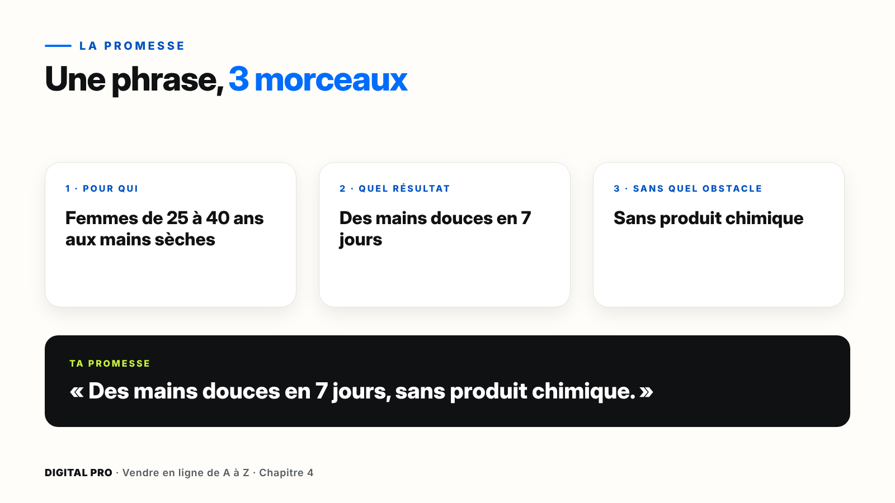
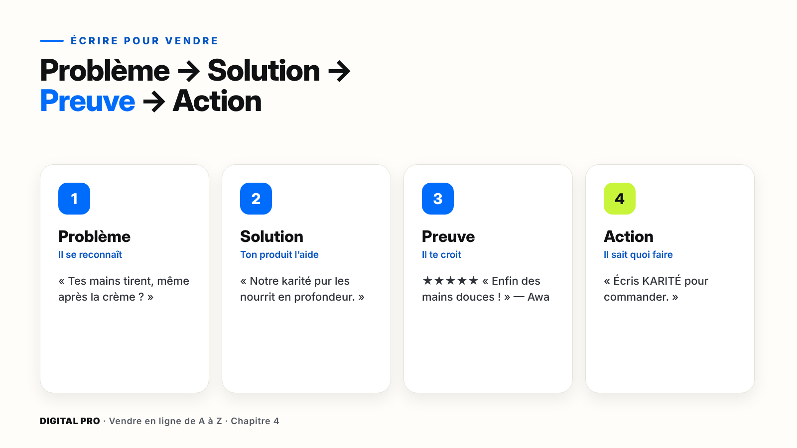
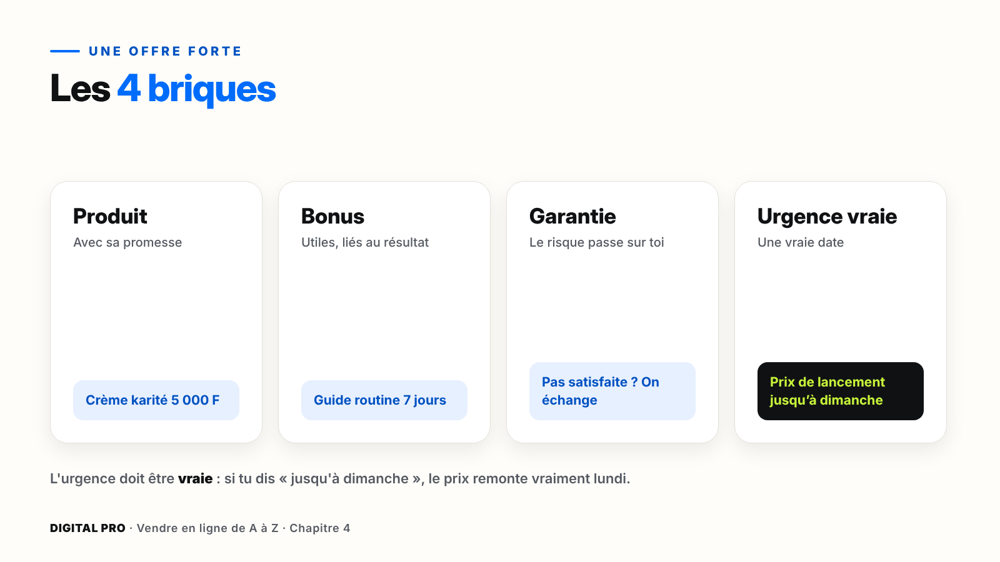
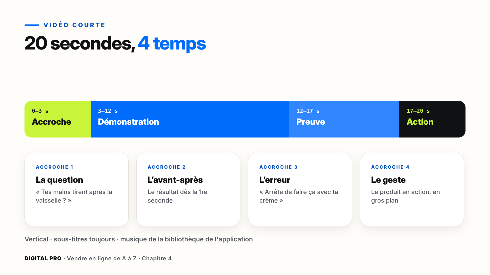

# Chapitre 4 — Le message qui fait vendre

`[PHOTO]` **Ouverture, pleine page** : une vendeuse filme son produit en gros plan avec son téléphone, près d'une fenêtre. À côté, un carnet ouvert où l'on lit quatre mots écrits à la main : Problème, Solution, Preuve, Action.

> **La promesse de ce chapitre** : tu repars avec ton kit de vente complet. Une promesse claire, un texte qui vend, des preuves vraies, une offre forte, trois visuels et une vidéo courte. Et tout ça sans mentir.

---

## Ce que tu vas faire dans ce chapitre

- ☐ Écrire ta promesse en une phrase
- ☐ Écrire ton texte de vente en 4 étapes
- ☐ Rassembler tes 3 premières preuves
- ☐ Construire ton offre (bonus, garantie, urgence vraie)
- ☐ Créer 3 visuels avec ta mini-charte
- ☐ Filmer une vidéo de 20 secondes
- ☐ Utiliser l'IA pour t'aider à écrire, sans perdre ta voix

**Ce qu'il te faut** : ton téléphone, Canva, CapCut, un assistant IA, et ta fiche « Mon projet » (partie 18).

---

## 4.1 — La promesse

Sur un téléphone, ton client te donne **trois secondes**. S'il ne comprend pas tout de suite ce qu'il gagne, il fait défiler.

**La formule** : pour **qui** + quel **résultat** + sans quel **obstacle**.

| Trop flou | Une vraie promesse |
| --- | --- |
| Crème de qualité | Des mains douces en 7 jours, sans produit chimique |
| Ebook de cuisine | 30 repas sains pour la famille, prêts en 30 minutes |
| Formation Excel | Ton 1er tableau de bord en 1 week-end |

> **Attention** — Une promesse doit être **vraie et tenable**. Jamais « guérit tout », jamais « riche en 7 jours ». Les plateformes publicitaires bloquent ces messages, et un client trompé ne revient pas.

**Pas à pas** : écris 3 versions, lis-les à voix haute, garde la plus claire. Puis lis-la à quelqu'un de ta cible : s'il répond « ah, c'est pour moi », c'est gagné.

---

## 4.2 — Écrire pour vendre

Pas besoin d'être un grand écrivain : il faut une méthode, en 4 étapes, toujours dans le même ordre.

| Étape | Le but | Exemple |
| --- | --- | --- |
| **Problème** | Il se reconnaît | « Tes mains sont sèches et tirent, même après la crème ? » |
| **Solution** | Ton produit l'aide | « Notre crème au karité pur les nourrit en profondeur. Des mains douces en 7 jours. » |
| **Preuve** | Il te croit | ★★★★★ « Enfin des mains douces ! » — Awa, Abidjan |
| **Action** | Il sait quoi faire | « Écris KARITÉ pour commander. » |

| À éviter | À préférer |
| --- | --- |
| Formule révolutionnaire | Ta peau est douce dès le 3e jour |
| Nous sommes leaders du marché | Déjà 300 clientes à Abidjan *(si c'est vrai)* |
| Contactez-nous pour plus d'informations | Écris « OUI » sur WhatsApp |

> **Astuce** — Écris comme si tu parlais à **une seule personne**. Phrases courtes, une idée par paragraphe : c'est ce qui se lit sur un téléphone.

---

## 4.3 — Les preuves qui rassurent

En ligne, ton client a peur : que le produit ne marche pas, de ne jamais être livré. Tu le rassures avec des **preuves vraies**.

| Preuve | Comment l'obtenir |
| --- | --- |
| **Vrais avis** | Captures de messages, avec l'accord du client (prénom seulement) |
| **Démonstration** | Une vidéo du produit en action |
| **Ton visage** | Montre qu'il y a une vraie personne derrière |
| **Garantie** | « Pas satisfait ? On échange ou on rembourse. » |

### Pas à pas : demander un avis

**Marche 1** — Trois jours après la livraison, écris : « Bonjour Awa ! Comment trouves-tu ta crème ? »
**Marche 2** — Laisse la cliente répondre avec ses propres mots : ce sont les meilleurs.
**Marche 3** — Demande toujours : « Puis-je partager ton message, avec ton prénom ? »

> **À éviter** — Les **faux avis**, inventés ou achetés. C'est malhonnête, souvent illégal, et un seul faux avis découvert détruit ta confiance.

> **Astuce** — Pas encore de clients ? Offre ton produit à **3 personnes de ta cible** contre un avis honnête.

---

## 4.4 — Une offre irrésistible

| Offre simple | Offre forte |
| --- | --- |
| Crème 5 000 F | Crème + guide routine 7 jours |
| Pas de garantie | Pas satisfaite ? On échange |
| Disponible toujours | Prix de lancement jusqu'à dimanche |

> **Attention** — L'urgence doit être **vraie**. Si tu annonces « jusqu'à dimanche », le prix remonte vraiment lundi. Les faux comptes à rebours font fuir les clients.

---

## 4.5 — Tes visuels avec Canva

**Ta mini-charte**, décidée une fois pour toutes : **2 couleurs** (une principale, une d'accent), **2 polices** (titres et texte), **ton logo** toujours au même endroit.

### Pas à pas : ton visuel

**Marche 1** — Dans Canva, choisis le format : **Story** (vertical) ou **Publication** (carré).
**Marche 2** — Prends un **modèle sobre** : moins d'éléments, message plus clair.
**Marche 3** — Applique ta charte et remplace la photo par **la tienne**.
**Marche 4** — **Partager** › **Télécharger** › **PNG**.

**Le contrôle avant de publier** : lisible sur un petit écran ☐ · un seul message ☐ · ton vrai produit ☐ · une action claire ☐

> **Astuce** — Crée **3 visuels d'un coup** avec le même modèle : la promesse, la preuve, l'offre. Tu as une semaine de publications.

---

## 4.6 — Les vidéos courtes qui vendent

Les **3 premières secondes** décident de tout. Pas de logo, pas de « bonjour à tous » : on entre directement dans le sujet.

| Temps | Contenu |
| --- | --- |
| 0 à 3 s | L'accroche : question, avant-après, erreur ou geste |
| 3 à 12 s | La démonstration |
| 12 à 17 s | La preuve |
| 17 à 20 s | L'action : « Écris KARITÉ en commentaire » |

> **Astuce** — Beaucoup regardent **sans le son** : ajoute toujours les sous-titres. Filme en **vertical**, près d'une fenêtre.

> **Attention** — Utilise la musique de la **bibliothèque de l'application**. Une musique protégée peut faire bloquer ta vidéo ou ta publicité.

---

## 4.7 — L'IA pour écrire, sans perdre ta voix

L'IA écrit vite ; toi, tu connais ton client. Un bon prompt contient **4 informations** :

1. **Le rôle** : « Tu es un rédacteur spécialisé dans la vente sur WhatsApp. »
2. **Le contexte** : produit, prix, cible, promesse.
3. **La tâche** : « Écris 5 accroches de vidéo. »
4. **Le format** : longueur, ton, tutoiement.

**Exemple de prompt** :

> « Tu es rédacteur. Je vends une crème au karité à 5 000 F à des femmes de 25 à 40 ans à Abidjan qui ont les mains sèches. Écris 5 accroches de vidéo de moins de 10 mots, en tutoyant. »

**Avant de publier, relis toujours** : est-ce **vrai** (l'IA invente parfois des chiffres) ? Est-ce que ça sonne **comme toi** ? Est-ce que ça parle **à ta cible** ?

> **À retenir** — L'IA **propose**, c'est toi qui **décides**. Ne publie jamais un texte que tu n'as pas relu. Au module 13, on ira plus loin avec l'IA pour automatiser.

---

## À retenir

1. Une promesse **vraie**, en une phrase : pour qui, quel résultat, sans quel obstacle.
2. **Problème → Solution → Preuve → Action**, avec des mots concrets.
3. Des preuves et une urgence **toujours vraies**.
4. Une mini-charte, 3 visuels, une vidéo qui accroche en 3 secondes.

---

## Ta checklist du chapitre 4

- ☐ Ma promesse est écrite et testée
- ☐ Mon texte de vente en 4 étapes est prêt
- ☐ J'ai mes 3 premières preuves (avec accord)
- ☐ Mon offre a ses 4 briques
- ☐ Mes 3 visuels sont créés avec ma mini-charte
- ☐ Ma vidéo de 20 secondes est filmée et sous-titrée
- ☐ J'ai testé l'IA, relu et corrigé
- ☐ J'ai fait le quiz du module 4

**Tout est coché ?** Ton kit de vente est complet. Rendez-vous au chapitre 5 : ta page de vente et ta boutique.
