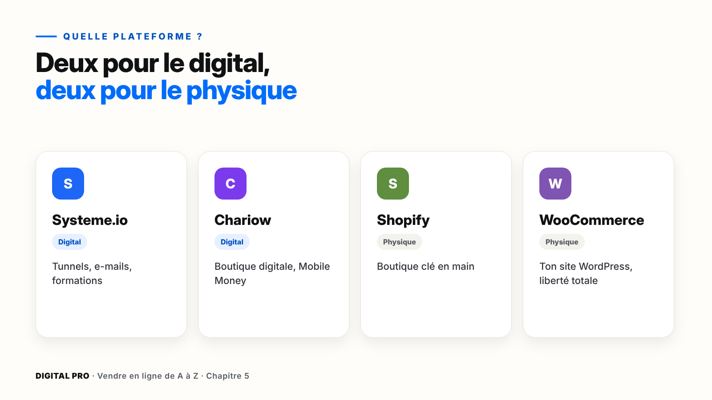
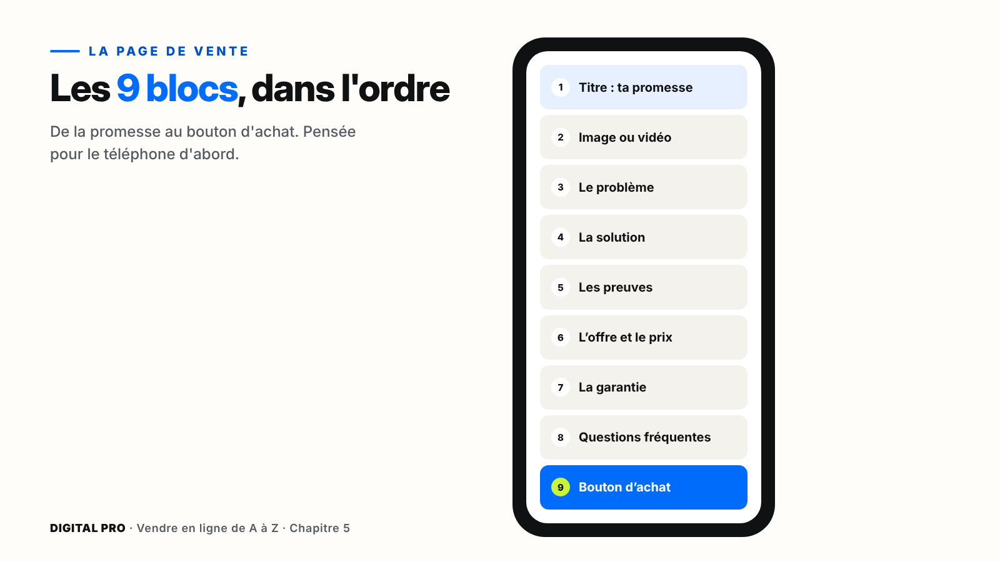

# Chapitre 5 — Ta page de vente et ta boutique

`[PHOTO]` **Ouverture, pleine page** : un téléphone tenu en main, qui affiche une page de vente claire avec un gros bouton « Je commande ». En arrière-plan flou, un ordinateur portable ouvert sur l'éditeur de la page.

> **La promesse de ce chapitre** : ta page de vente ou ta boutique est en ligne, sur la bonne plateforme, avec ton nom de domaine, et elle a passé la checklist en 20 points.

*Ce chapitre a deux parcours. Digital : sections 5.3 à 5.6. Physique : sections 5.7 à 5.10. Tout le monde : 5.1, 5.2, 5.11 et 5.12.*

---

## Ce que tu vas faire dans ce chapitre

- ☐ Choisir ta plateforme
- ☐ Écrire le contenu de tes 9 blocs
- ☐ Créer ta page ou ta boutique sur ta plateforme
- ☐ Ajouter tes pages légales
- ☐ Connecter ton nom de domaine
- ☐ Passer la checklist en 20 points et publier

**Ce qu'il te faut** : ton kit de vente (chapitre 4), tes photos, ton prix, et ta fiche « Mon projet » (partie 19).

> **Attention** — Les plateformes changent souvent leurs écrans. Si un bouton n'est pas au même endroit, cherche **le même mot** dans le menu : la logique reste la même. Les prix et les frais aussi changent : vérifie-les sur le site au moment de t'inscrire.

---

## 5.1 — Quelle plateforme pour toi ?

| Ta situation | Ta plateforme |
| --- | --- |
| Un produit digital + des e-mails automatiques | **Systeme.io** |
| Des produits digitaux payés surtout en Mobile Money | **Chariow** |
| Des produits physiques, sans technique | **Shopify** |
| Un site WordPress, contrôle total | **WooCommerce** |

> **Astuce** — Commence avec **une seule** plateforme, en version gratuite ou d'essai. Ton produit et tes textes restent les mêmes si tu changes plus tard.

---

## 5.2 — Les 9 blocs d'une page qui vend

1. **Le titre** : ta promesse.
2. **Une image ou une vidéo** du produit.
3. **Le problème** de ton client.
4. **La solution** et ce qu'elle contient.
5. **Les preuves** : avis, démonstration.
6. **L'offre et le prix**, avec les bonus.
7. **La garantie**.
8. **Les questions fréquentes** : ce sont les questions qu'on te pose sur WhatsApp.
9. **Le bouton d'achat**, répété plusieurs fois.

> **Attention** — La grande majorité de tes visiteurs arrivent sur téléphone. Textes courts, gros boutons.

---

## 5.3 et 5.4 — Systeme.io *(parcours digital)*

Systeme.io réunit les tunnels de vente, les e-mails et l'espace membre pour tes formations. Il existe un **plan gratuit** pour démarrer (au moment de l'écriture : 3 tunnels et 2 000 contacts ; vérifie les conditions actuelles).

### Pas à pas : ton premier tunnel

**Marche 1** — Crée ton compte gratuit avec ton e-mail pro.
**Marche 2** — **Tunnels** › **Créer** › objectif **Vendre un produit**.
**Marche 3** — Nomme ton tunnel, choisis ta devise, enregistre.

Ton tunnel contient **3 pages** :

| Page | Ce que tu y mets |
| --- | --- |
| **Page de vente** | Un modèle simple, rempli avec tes 9 blocs et tes images |
| **Bon de commande** | Ton offre (nom du produit + prix). Le paiement se branche au chapitre 6 |
| **Remerciement** | Un message chaleureux + le bouton vers ton produit (livraison automatique) |

> **Astuce** — Ajoute un **e-mail automatique** après l'achat, avec le lien du produit : si le client ferme la page, il retrouve tout dans sa boîte mail.

---

## 5.5 et 5.6 — Chariow *(parcours digital)*

Chariow est une plateforme de boutique de produits digitaux pensée pour l'Afrique : **Mobile Money et cartes**, **livraison automatique**, et un **filigrane** avec l'e-mail de l'acheteur sur les fichiers.

### Pas à pas : ta boutique et ton produit

**Marche 1** — Crée ton compte avec ton e-mail pro, nomme ta boutique, choisis son adresse.
**Marche 2** — Ajoute ton logo et ta couleur principale.
**Marche 3** — Renseigne où recevoir tes gains. **Vérifie les frais et délais de versement** affichés dans ton compte.
**Marche 4** — **Produits** › **Ajouter** : titre (ta promesse), description (tes blocs), prix, fichier à livrer. **Publier**.
**Marche 5** — Crée un **code promo** (ex. LANCEMENT, −20 %) avec une **vraie date de fin**.
**Marche 6** — Fais un **achat test** : paiement, e-mail, livraison du fichier.

---

## 5.7 et 5.8 — Shopify *(parcours physique)*

Shopify est une boutique **clé en main** : hébergement, sécurité et mises à jour sont gérés. Un essai pour tester, puis un abonnement mensuel. **Note la date de fin de l'essai** et vérifie les frais selon ta solution de paiement (chapitre 6).

### Pas à pas : ta boutique

**Marche 1** — Commence l'essai avec ton e-mail pro, nomme ta boutique, indique ton pays.
**Marche 2** — **Boutique en ligne** › **Thèmes** : choisis un thème **gratuit et sobre**.
**Marche 3** — Personnalise : logo, couleurs (ta mini-charte).
**Marche 4** — **Produits** › **Ajouter** : titre clair avec la quantité, description, tes 10 photos et ta vidéo, prix, suivi du stock.
**Marche 5** — Crée des **collections** : par usage, par besoin, et une pour les offres.
**Marche 6** — **Paramètres** › **Expédition et livraison** : crée tes zones (chapitre 3B). Active le **paiement à la livraison** dans les paiements manuels si tu le proposes, et confirme chaque commande avant d'envoyer le livreur.

---

## 5.9 et 5.10 — WooCommerce *(parcours physique)*

| Shopify | WooCommerce |
| --- | --- |
| Tout est géré pour toi | Tu gères ton site toi-même |
| Abonnement mensuel | Extension gratuite + hébergement |
| Moins de liberté | Liberté totale |

### Pas à pas : installation et produits

**Marche 1** — Prends un hébergement qui installe **WordPress en un clic**, avec ton nom de domaine (5.11).
**Marche 2** — **Extensions** › **Ajouter** › cherche **WooCommerce** › **Installer** › **Activer**.
**Marche 3** — Suis l'assistant : adresse, type de produits, devise.
**Marche 4** — **Produits** › **Ajouter** : nom, description, tarif, gestion du stock, image et galerie. **Publier**.
**Marche 5** — **WooCommerce** › **Réglages** › **Expédition** : une zone par secteur, avec un forfait.

> **Attention** — Avec WordPress, c'est toi le responsable technique : mises à jour, sécurité, et surtout **sauvegardes automatiques**.

### Les 4 pages légales (toutes plateformes)

Conditions générales de vente · politique de confidentialité · retours et remboursements · mentions et contact. Les règles changent selon ton pays : pars des modèles de ta plateforme, adapte-les, et fais-les relire en cas de doute.

---

## 5.11 — Ton nom de domaine

| Adresse par défaut | Ton nom de domaine |
| --- | --- |
| douceur-karite.myshopify.com | douceurkarite.com |
| aminata.cosmetiques@gmail.com | contact@douceurkarite.com |

**Un bon domaine** : court, facile à dire, sans tiret ni chiffre, en .com ou avec l'extension de ton pays (.ci, .sn, .cm…).

**Marche 1** — Achète-le chez un registraire ou sur ta plateforme (paiement annuel).
**Marche 2** — Dans ta plateforme : **Paramètres** › **Domaines** › **Connecter un domaine existant**, et suis les instructions.
**Marche 3** — Attends la vérification : de quelques minutes à 48 heures.

> **Astuce** — Beaucoup de registraires proposent une **redirection d'e-mail** : contact@tondomaine.com arrive dans ton Gmail.

---

## 5.12 — La checklist avant de publier

Avant de payer la moindre publicité, teste tout **sur ton téléphone, en 4G, comme un vrai client**. La checklist complète en **20 points** est dans ta fiche (partie 19) : titre lisible, page rapide, bouton visible, paiement jusqu'au bout, produit bien reçu, pages légales, domaine, et 3 testeurs.

---

## À retenir

1. **Une** plateforme adaptée à ton parcours, en version gratuite ou d'essai.
2. **9 blocs**, pensés pour le téléphone.
3. Pages légales, nom de domaine, et un **achat test** avant tout.

---

## Ta checklist du chapitre 5

- ☐ Ma plateforme est choisie
- ☐ Mes 9 blocs sont écrits et en ligne
- ☐ Mes 4 pages légales sont publiées
- ☐ Mon nom de domaine est connecté
- ☐ J'ai fait un achat test
- ☐ La checklist en 20 points est passée
- ☐ J'ai fait le quiz du module 5

**Tout est coché ?** Ta page est en ligne. Rendez-vous au chapitre 6 : encaisser les paiements, Mobile Money compris.
